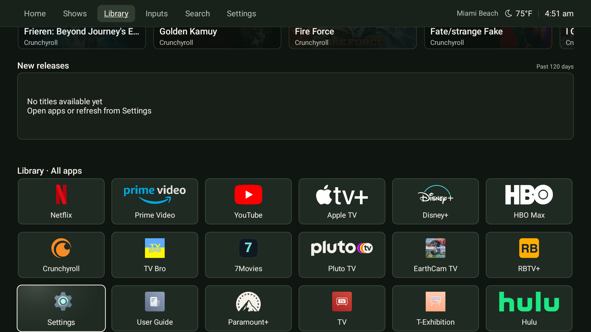
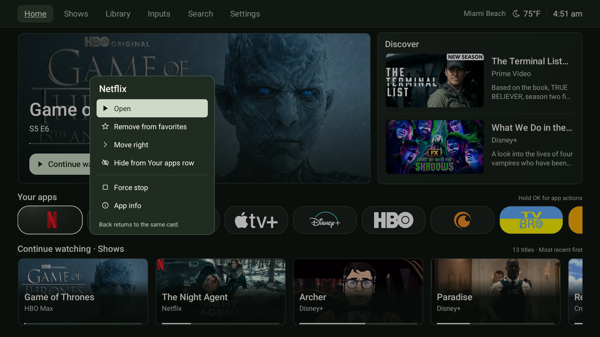

# prettTV

**A quieter home for Android TV.** Your apps, viewing progress and something new to watch, in three native layouts.

[**Download the latest release**](https://github.com/draco1738/prettTV/releases/latest) · [Installation](docs/installation.md) · [Documentation](docs/README.md) · [Credits](THIRD_PARTY_NOTICES.md)

[](https://github.com/draco1738/prettTV/actions/workflows/build.yml)
[](https://github.com/draco1738/prettTV/releases/latest)


*C · Balanced is the default. The A/B/C gallery shows 0.4.0 running on the TCL TV, including persistent top navigation and the refined Home cards. These are device captures, not rendered mockups.*

**0.4.0 source:** Six visual refinements and persistent opaque top navigation are implemented here. See the [versioned validation record](docs/validation.md) for actual checks, evidence and limitations; earlier results do not certify a newer build.

## A home that stays out of the way

- **Pick your layout.** Cinema, Quiet or Balanced, with persistent Home, Shows, Library, Inputs, Search and Settings navigation above the content.
- **Put recent viewing first.** A large feature and separate Shows and Movies rows use supported app progress and locally confirmed playback.
- **Keep your apps close.** Narrower dark tiles with softer corners and tighter spacing, favorites first, and a finite row with a clear start and end. Hide an app from the row while keeping it in Library.
- **Follow the focus.** A soft ivory spotlight, a small artwork shift and reserved metadata space make the selected card clear without moving the rows. Each movement settles; cards do not animate continuously while idle.
- **Save something for later.** A dedicated Watchlist row keeps your saved titles and their app destinations. Follow shows separately for new-episode alerts.
- **Make the rows yours.** Reorder or hide content rows, choose card sizes, and browse 20, 40 or 60 discovery titles per row. Suggestions, Discover and Trending put preferred services first.
- **Follow your teams.** Favorite teams move up Live sports, with optional kickoff reminders while Home is visible.
- **Keep shared accounts personal.** Hide individual titles from the feature or Continue watching without changing anyone else's streaming account.

Built on [Rivi by Jommi](https://github.com/jommi9/rivi), using native Android Views/Canvas, progressive artwork loading and bounded caches. No third-party UI framework or analytics SDK.

> [!NOTE]
> Viewing progress and recommendations depend on what each app shares with Android TV. prettTV does not access a universal streaming history or detect every signed-in account. [How content works →](docs/content-and-sports.md)

Home also retains recent content during outages, offers undo for supported changes, and checks for official updates without installing anything automatically. [Explore the controls →](docs/usage.md)

**In 0.4.0:** The hero separates the title, supplied episode details, valid progress/remaining time and source app around one clear action. Hold OK opens a compact dark app panel with Open focused first; Force stop retains its separate Cancel-first confirmation. Stronger section headings, brief hold/end feedback, and refreshes that retain cards and artwork complete the six refinements. The opaque top bar stays visible in every layout; weather freshness is available in Settings without a cached label beside the temperature.

Continue watching reorders promptly by supported recency while keeping the selected title focused. The hero follows the latest eligible record. Observed changes in provider progress remain separate from confirmed local playback: timestamp refreshes alone never promote a title, and provider observations do not automatically remove titles from Watchlist. Choosing Home in the top bar resets the page and all rows to their default start, matching the remote's Home action.

**Added in v0.3.2:** Hold OK on an installed app in Your apps or Library to choose [Force stop](docs/usage.md#restart-an-apps-connections). Confirm to close that app, then choose Done or Open app to reconnect. Logins and saved data are kept. Direct stopping requires the existing authorized TV-local recovery connection; otherwise App info provides Android's control. Home and essential TV services are protected. [Validation results →](docs/validation.md)

**Added in v0.3.1:** The optional [Settings-button helper](docs/usage.md#remote-settings-button) restores access to TCL's native quick-settings panel across apps, with standard Android Settings as a fallback. It leaves Home and other buttons alone and does not read screen content.

**Added in v0.3.0:** [Blind Pick and Rabbit Hole](docs/original-apps.md) add concealed choices and title connections at the bottom of Library. Library also uses consistent dark cards with readable app marks. The upper Your apps row stays unchanged. The optional [EarthCam idle handoff](docs/earthcam-idle.md) reached live playback after ten minutes without input on the TCL, with repeated system **Start now** activation and **Home** exit also verified.

**Weather beside the clock:** v0.2.3 adds an optional location, condition icon and temperature to the existing header. Enter a US ZIP code in Weather settings and choose °F or °C. Readings come from nearby NWS observation stations; no GPS permission or Google account access is needed. [Weather settings and coverage →](docs/usage.md#weather-beside-the-clock)

## Get started

You need **Android TV 8.0 or newer** and a computer with an authorized **ADB** connection.

1. Download and extract the **`prettTV-…-with-RBTV.zip`** bundle from [Releases](https://github.com/draco1738/prettTV/releases/latest).
2. Open a terminal in the extracted folder and run the command for your computer, replacing `TV_SERIAL_OR_ADDRESS` with the device shown by `adb devices`.
3. In prettTV, allow **TV listings**, then use **Settings → Choose default Home app**. C Balanced is selected by default.

**Windows · PowerShell**

```powershell
.\install.ps1 -Tv 'TV_SERIAL_OR_ADDRESS'
```

**macOS / Linux · Bash**

```bash
TV='TV_SERIAL_OR_ADDRESS' bash ./install.sh
```

The default bundle includes **RBTV+** and keeps an existing RBTV installation. Add `-LauncherOnly` on Windows or `--launcher-only` in Bash to skip it. A standalone prettTV APK installs or updates only the launcher.

[Full installation guide](docs/installation.md) · [RBTV provenance and limits](docs/companion-apps.md)

## Three layouts, one library

Choose a layout in **prettTV Settings → Layout**. Your apps, viewing history and discovery feeds are shared across all three.

Your apps retains the **36-pixel corners** introduced in v0.2.2, with 208-pixel widths, 12-pixel gaps and layout-specific heights. Library geometry and focus motion are unchanged. The [app-card comparison](docs/previews/rounder-36/README.md) records the approved shape as a rendered concept; [validation history](docs/validation.md) records native checks and their outcomes.

| Layout | Composition |
| :--- | :--- |
| **A · Cinema** | A wide feature puts the current title first. |
| **B · Quiet** | Apps first, with content rows below. |
| **C · Balanced** | A large feature, two discovery cards and a compact app row. **Default.** |

<details>
<summary><strong>View A · Cinema</strong></summary>


</details>

<details>
<summary><strong>View B · Quiet</strong></summary>


</details>

<details>
<summary><strong>Persistent navigation and app actions</strong></summary>

The opaque top bar remains visible while content scrolls. Hold OK on an installed app to open its contextual action panel with Open selected first.





</details>

<details>
<summary><strong>Explore the content rows</strong></summary>

Continue watching · Shows → Continue watching · Movies → Watchlist → New episodes when available → Live sports → Suggestions → Discover → Trending → New releases.

This is the default order; **Settings → Customize rows** lets you change it. The separate discovery capture below is historical: it predates the additional rows and 0.4.0 navigation.


</details>

## Just a remote

| Control | Action |
| :--- | :--- |
| **Arrows / OK** | Move between cards / open the selected item. |
| **Hold OK** | Arrange apps; save, follow, dismiss or inspect a title; correct recent viewing. |
| **Left / Right at row ends** | Stop at the first / last card; rows do not wrap. |
| **Up from the first content card / Down from navigation** | Reach the top bar / return to the remembered content card. |
| **Back from content** | Return to the top. |
| **Menu** | Open prettTV Settings. |

[App arrangement, title controls and settings →](docs/usage.md)

## Recovery, when you need it

**Settings → Return to stock Google TV** requires two confirmations. It restores the recorded TCL/Google app states, original Private DNS and Google TV Home while retaining streaming apps, logins and prettTV.

Full recovery needs the original private setup record and authorized local TCP debugging. It is available once those prerequisites are configured; it is not a factory reset.

[Set up stock recovery](docs/stock-recovery.md) · [Privacy and permissions](docs/privacy.md) · [Uninstall safely](docs/installation.md#restore-or-uninstall)

## Build, verify, contribute

Use **JDK 17**, **Android SDK 34** and **build-tools 35.0.0**. The [development guide](docs/development.md) covers source builds, signing and the test setup.

Release checks cover JVM tests, Android lint, isolated device tests, navigation, lifecycle, failure handling and measured scrolling. [Validation history](docs/validation.md) records completed checks and their limitations for each release; earlier results do not certify a newer build.

## Built with credit

prettTV is derived from **Rivi v0.15**, Copyright © 2026 Jommi, under the [MIT License](LICENSE). Its source history, original notices and [upstream README](docs/upstream-rivi-readme.md) are retained.

[PLUI by Smartago](https://github.com/smartago/plui-tv-launcher) and stock Google TV informed the design. Their implementation and artwork are not redistributed. App icons, data providers, artwork and the separate RBTV companion retain their respective rights and attribution.

[Full credits and third-party notices →](THIRD_PARTY_NOTICES.md)
