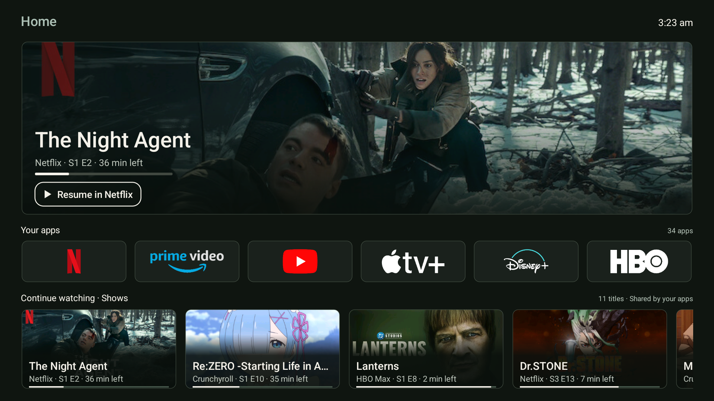
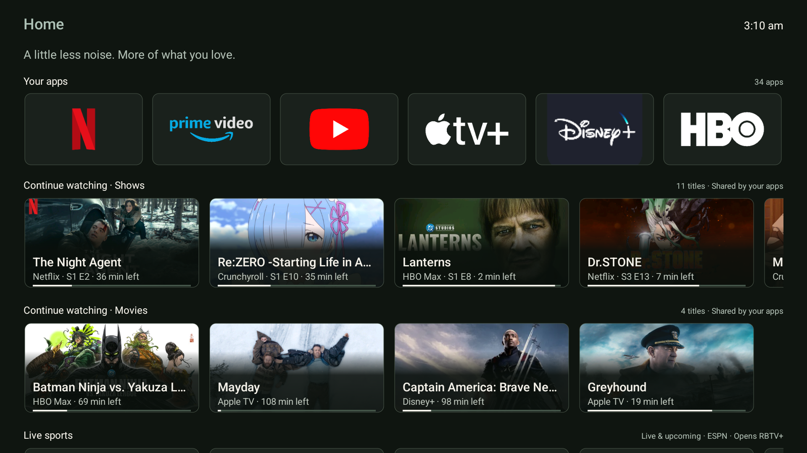
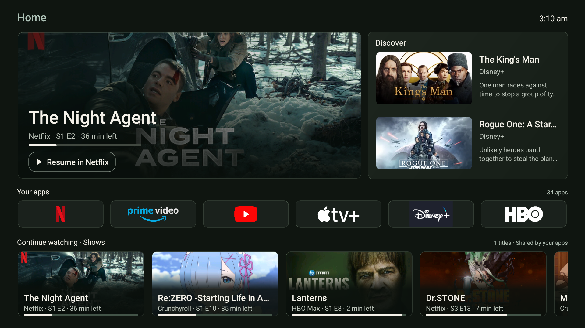
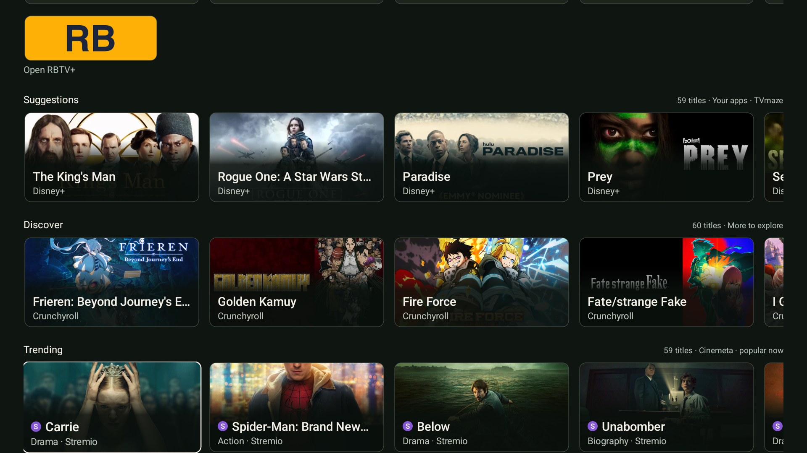

# prettTV

A small native Android TV launcher built on [Rivi](https://github.com/jommi9/rivi), by Jommi. Three working layouts share an automatically hidden left sidebar, the same apps, viewing progress and discovery feeds. **C — Balanced** is the default. **RBTV+ is included in the default installation bundle.**

- **A · Cinema:** wide feature with hidden left navigation.
- **B · Quiet:** apps first, followed by content rows.
- **C · Balanced:** large feature, two discovery cards and a compact app row.

Both Continue watching rows are sorted newest first. The large feature chooses the most recent **locally confirmed playback**, with provider timestamps as an initial baseline, including Stremio. Below the apps are **Continue watching · Shows**, **Continue watching · Movies**, **Live sports**, **Suggestions**, **Discover**, **Trending** and **New releases**. Content rows scroll horizontally with up to 60 titles. The finite app row contains every included launchable app, favorites first, with a clear beginning and end. Home resets it to the first app.

Hold OK on a title to hide it from the large feature, Continue watching, or both. **Settings → Hidden titles** restores titles individually. Filters stay on this TV and do not alter shared streaming accounts. Matching uses normalized titles across sources; identically named remakes share a filter.

## Install and use

Download and extract **prettTV-0.1.6-with-RBTV.zip** from [Releases](https://github.com/draco1738/prettTV/releases). Connect an authorized Android TV through ADB, then run `./install.ps1` on Windows or `./install.sh` on macOS/Linux. The bundle installs both prettTV and RBTV+ by default, verifies the pinned RBTV checksum, and preserves any RBTV version already installed. Use `-Tv <serial>` / `TV=<serial>` to select a TV. Android TV 8.0 / API 26 or later is required.

When installing from a source checkout, the scripts build prettTV and fetch the pinned RBTV asset from the public release if needed. `-NoBuild` / `--no-build` reuses the built APK. `-LauncherOnly` / `--launcher-only` explicitly skips RBTV. A bare prettTV APK updates only the launcher; use the complete bundle for the default two-app installation.

Allow **TV listings** so prettTV can read shared program rows. No streaming login is needed. The Android package is `dev.zane.pretttv`; builds with this package update in place. This release changes the provisional package identity. The owner’s preferences were backed up locally, migrated and verified before selecting the renamed Home and removing the previous package.

Hold OK on an app → **Hide from Your apps row** removes it only from the horizontal row. It stays in **Library**, search and viewing history. To restore it, hold OK in Library → **Show in Your apps row**, or use Settings → Restore apps to Your apps row. Settings → Choose apps one by one walks through every launchable app, including sideloaded apps with ordinary Android launch entries. Projectivy and LTvLauncher are excluded. Settings → Live sports apps chooses shortcuts for that row. RBTV+ is the default sports app; SportioTV and HD Streamz were removed at the owner's request.

Hiding an app keeps your place: focus moves to the next visible app, or the previous one at the end, while preserving the row's scroll position. Hiding from Library keeps focus on that same Library tile. Favorite rearrangement follows the moved app. These local arrangement changes do not restart the recommendation feeds.

Use arrows and OK; hold OK for app arrangement or title controls. Press Left from the first card to reveal navigation. Right, Back or choosing a destination hides it. Back from content returns to the top. Menu opens settings: layout, discovery, HDMI inputs, system settings, hidden titles and credits. Home selection uses Android's normal Home mechanism without an accessibility interception service.

## What the feeds mean

Continue watching reads Android TV Watch Next and app-published continuation channels. These are shared data sources used by TV launchers, not a copy of Google's private account database. Coverage varies and shared profiles can contribute other people's titles. A provider timestamp refresh alone no longer moves a title to the top. Initial provider ordering is retained until playback is confirmed locally. Settings → Playback tracking explains optional Notification access, which Android requires to observe active media sessions; prettTV does not read notification text. A title is recorded only when identifiable metadata matches a known shared title, the session has been playing for at least 15 seconds, and its duration is at least three minutes. Apps omitting usable metadata remain unsupported; no universal or perfect history is claimed. Hold OK → **I watched this most recently** corrects stale ordering locally. This does not change the streaming account. Unknown content types are not guessed into Shows or Movies. If no eligible watching item exists, the hero falls back to discovery.

Suggestions, Discover and Trending prioritize app cards from services with shared viewing progress. **Settings → Recommendation services** lets you choose your signed-in services explicitly; **Use viewing activity** restores automatic inference. Android does not expose a reliable cross-app login flag, and a shared record does not prove a current login. Opening an app alone does not mark it as signed in. Some services share Continue watching without sharing recommendations, so their private catalogs cannot be included automatically.

Providers are balanced before the 60-title limit, with cards reserved from each service for both Suggestions and Discover. This gives Discover a broader mix instead of leaving it with one anime feed. Selected services come first, followed by other app feeds, known free services and general catalog fallback. Stremio stays last and has a purple **S** badge. Duplicate normalized titles retain the preferred app source; Discover excludes titles already in watching, Suggestions, Trending and New releases.

Pluto TV has lower priority specifically in Suggestions and Discover: it fills remaining space after other sources, before Stremio. Opening Pluto or selecting it as a recommendation service does not override this lower priority. The app remains available normally; its viewing history and Trending ranking are unchanged.

Trending uses explicitly labeled popular/trending app channels and app cards matching a unique same-title, same-type entry in Cinemeta's Popular catalog. Matching only changes ranking: the provider's title, artwork and launch intent are retained. Unknown types and ambiguous catalog matches are skipped. Remaining slots use Cinemeta's Popular order, alternating series and films. New releases uses supplied dates within the past 120 days. Catalog presence does not guarantee a playable stream or subscription entitlement. Cinemeta cards link to Stremio; app-published cards use their provider's intent. No additional catalog requests were added for balancing or Discover.

Live sports pulls live/upcoming NFL, college football, NBA, NHL, MLB and Premier League fixtures from ESPN's public scoreboard feed. Cards use supplied broadcast logos and kickoff times; live cards include scores. Requests run while Home is visible, with a two-minute cache. Data older than five minutes loses its LIVE label/score, and records expire after fifteen minutes. These are uncontracted endpoints and may become unavailable.

**A network logo is not a stream link.** The optional **prettTV game handoff** accessibility helper opens RBTV 3.0.320, selects a verified sport tab, and looks for both complete team names and the local kickoff/date. It supports NFL, college football, NBA and Premier League in that pinned version. It stops after opening the matching game; server selection remains yours. Requests expire after 30 seconds or 16 list scrolls. Ambiguous, missing, unsupported or differently timed events fall back to manual selection. The helper reads and operates RBTV only during an explicit request, never intercepts Home, and never accepts updates or chooses servers. Enable it in Android Accessibility settings. Other RBTV versions/leagues use the ordinary app-launch fallback. Upcoming games may show a countdown rather than server choices.

The [release](https://github.com/draco1738/prettTV/releases/tag/v0.1.6) contains the default prettTV + RBTV installation bundle, individual APKs and checksums. See [RBTV provenance and review limits](docs/companion-apps.md). RBTV is a separate third-party application with its own terms; prettTV’s MIT license does not cover it.

The UI uses native Views/Canvas, two artwork workers and bounded caches. Visible cards request artwork; off-screen cards release bitmap references. Each app appears once in the finite horizontal row, with shared artwork. Twelve bundled [Dashboard Icons](https://github.com/homarr-labs/dashboard-icons) PNG assets and an adapted Disney+ vector provide recognizable marks on dark tiles, with original color accents. Sources, pinned revision, hashes and the supplied license are included. Other apps use their installed artwork; source images are contained rather than stretched.

## Privacy and recovery

prettTV has no analytics SDK, advertising identifier access, account collection, root operation or firmware modification. It requests Internet and TV-listings access. Catalog and provider artwork requests reveal your IP address and requested URLs to their servers. Discovery can be disabled. App order, hidden titles, confirmed playback and launch recency stay local. Optional playback and RBTV helpers run only when Android special access is enabled; the installers do not grant that access. prettTV does not remove ads inside other apps.

The APK and installer do not disable system launchers. The owner's separate TCL setup disabled Google TV Home and its setup component so Home resolves to prettTV. **Restore a working Home before uninstalling prettTV.** With ADB:

```sh
adb shell pm enable --user 0 com.google.android.apps.tv.launcherx
adb shell pm enable --user 0 com.google.android.tungsten.setupwraith
adb shell cmd package resolve-activity --brief -a android.intent.action.MAIN -c android.intent.category.HOME
```

Select/open the returned Google Home component and verify it before uninstalling. `./restore.sh --stock-home` performs checks before removing prettTV. Plain `./restore.sh` requires another enabled Home. Private device rollback records are excluded from Git. These scripts do not undo other app or DNS changes.

## Build

Use JDK 17, Android SDK platform 34 and build-tools 35.0.0:

```sh
cd launcher
./gradlew :app:testReleaseUnitTest :app:assembleRelease
```

On Windows use `gradlew.bat`. Output: `launcher/app/build/outputs/apk/release/app-release.apk`. Configure `launcher/local.properties` with your SDK path. Private release signing uses ignored `launcher/signing.properties` with `storeFile`, `storePassword`, and `keyAlias`; otherwise builds use the local debug key. CI artifacts cannot update the owner's release-signed installation. Signing secrets are never committed.

70 JVM tests cover app ordering, content filtering, progress, chronology, release dates, long-row bounds, independent title hiding, app-hide focus continuity, service priority, provider variety and conservative popularity matching. See [validation notes](docs/validation.md). Upstream Rivi benchmarks are not prettTV benchmarks.

## Captured on the TCL TV

These are unedited screenshots of the actual native launcher on the owner's TV, published at the owner's explicit request, including public repository visibility. C remains selected on the TV. prettTV branding/credits are at the bottom of the page; subtle borders separate cards from the dark background.

### A · Cinema



### B · Quiet



### C · Balanced



### Suggestions, Discover and Trending



## Credits

Derived from **Rivi v0.15**, Copyright (c) 2026 Jommi, under the [MIT License](LICENSE). Source history and the [upstream README](docs/upstream-rivi-readme.md) remain intact. [PLUI](https://github.com/smartago/plui-tv-launcher) and stock Google TV informed the design; their proprietary implementation and artwork are not redistributed. TVmaze, Cinemeta, Metahub, ESPN, Kotlin and installed-app artwork are credited in [THIRD_PARTY_NOTICES.md](THIRD_PARTY_NOTICES.md), also available inside the APK.
