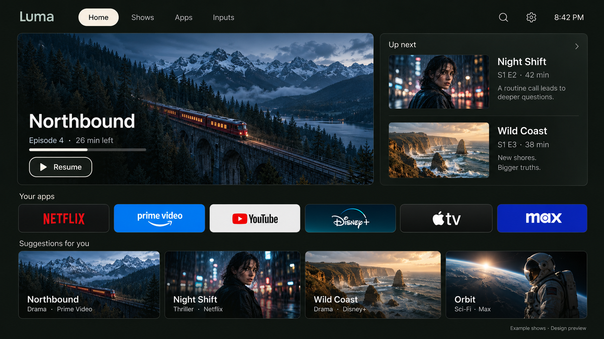
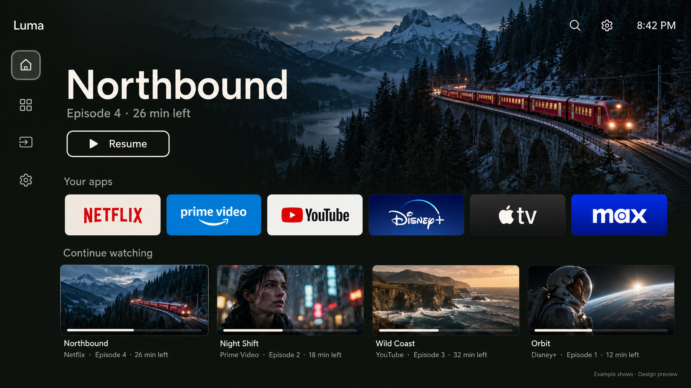
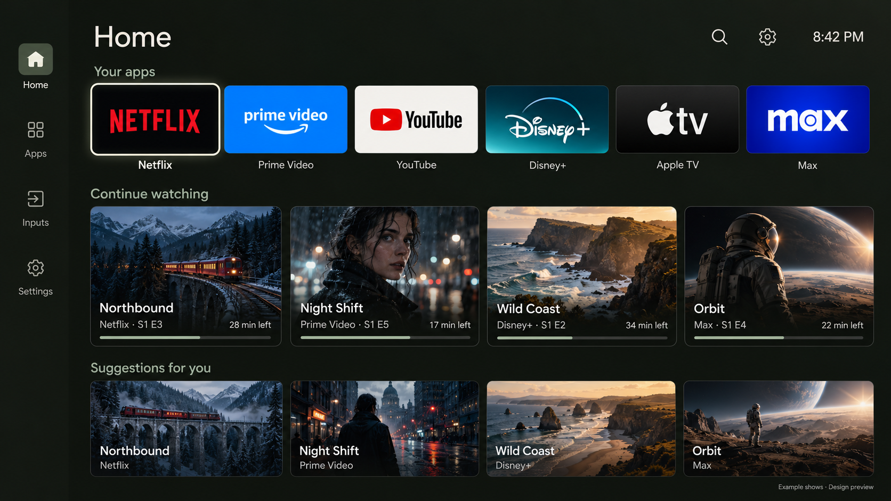

# Luma TV

A custom native Android TV launcher with three selectable layouts. **C — Balanced** is the intended default for the owner's TCL Google TV.

**Work in progress:** this repository contains the Rivi source foundation, approved previews, and architectural analysis. These images are mockups, not screenshots of a finished application. Implementation and hardware verification are underway.

| Layout | Focus |
| --- | --- |
| A — Cinema | Immersive feature, compact apps and Continue Watching |
| B — Quiet | Apps and content rows first |
| C — Balanced | Feature panel, Up Next, apps and suggestions together |

## C — Balanced · TV default

## A — Cinema

## B — Quiet

The previews use fictional example shows. Exact generation prompts accompany the PNG files in [docs/designs](docs/designs).

## Implementation direction

- Native Android Views and Kotlin, finite focus motion, cached artwork.
- Real installed apps, favorites, hidden apps, inputs and system settings.
- Android TV program rows where available; honest empty states and public-catalog discovery as a fallback.
- Three working layouts selectable in settings; C selected by default.
- No analytics, advertising identifiers or developer registration.

General discovery is not personalized watch history. No performance benchmark is claimed before testing the completed build.

## Source and credits

Based on [Rivi v0.15](https://github.com/jommi9/rivi/tree/v0.15), by Jommi, under the [MIT license](LICENSE). The [original README](docs/upstream-rivi-readme.md) is preserved; its benchmarks do not describe Luma.

[PLUI](https://github.com/smartago/plui-tv-launcher) and stock Google TV informed the design. PLUI's proprietary code and APK are not part of this repository. See [reverse-engineering notes](docs/reverse-engineering.txt).

Source lives in `launcher/`. Signing material and personal device snapshots stay outside this repository. Verified build instructions and release APKs will accompany the working implementation.
