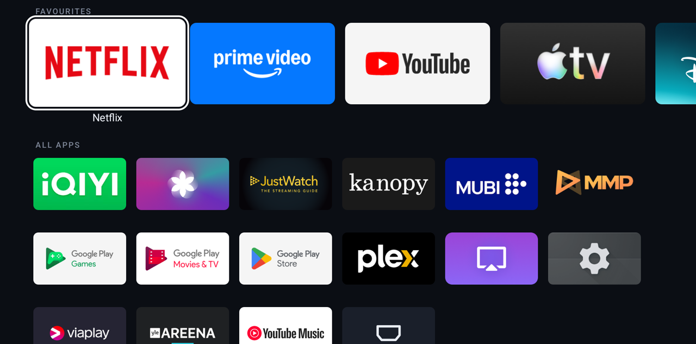

<div align="center">


# Rivi

### A tiny, fast home screen for Android TV and Google TV

[](https://github.com/jommi9/rivi/releases/latest)
[](https://github.com/jommi9/rivi/actions)


[](LICENSE)

[Why](#-why) • [Features](#-features) • [Install](#-install) • [Controls](#-controls) • [Undo](#-undo) • [Build](#-build-from-source)



</div>

---

## 🚀 Overview

**Rivi** shows your apps, opens them, and does nothing else. It is built for slow 2 GB projectors
and TVs, where the stock Google TV home screen keeps the CPU busy even when you are not touching
the remote. *Rivi* is Finnish for "row".

No ads, no recommendations, no account, no tracking, no internet permission.

## 📊 Why

Measured on a JMGO N1S projector (4× Cortex-A53, 2 GB RAM, Google TV on Android 14), home screen
idle for five minutes:

| | Google TV home | Rivi |
|---|:---:|:---:|
| Whole-device CPU while idle | 41% | **11–18%** |
| Home screen redraws per second | 60 | **0** |
| Home screen memory | 196 MB | **33 MB** |
| D-pad frame time, median / 99th percentile | 24 / 65 ms | **16 / 18 ms** |
| Netflix cold start to first frame | 984 ms | **796 ms** |
| YouTube cold start to first frame | 1262 ms | **965 ms** |

The stock home screen redraws 60 times a second whether or not anything moves. That is where the
CPU goes. Full numbers, method and caveats: [docs/RESULTS.md](docs/RESULTS.md).

> [!NOTE]
> **Tested on one device so far: the JMGO N1S.** It should work on other Google TV and Android TV
> devices running Android 8 or newer. Fire TV is not supported.
>
> **Have a different device? Please send your numbers.** Run the benchmark and open a pull request
> that adds a row to the [tested devices table](docs/RESULTS.md#tested-devices). Even a plain
> "works / does not work on my device" issue helps.
> ```bash
> export TV=<tv-ip>:5555
> bench/benchmark.sh idle my-device fi.jommi.rivi
> python3 bench/analyze.py idle results/runs/my-device
> ```

## ✨ Features

- **66 KB app.** One screen, native Android views, no libraries.
- **Zero work when idle.** No redraws, no background services, no polling.
- **Home button without disabling anything.** One switch under Accessibility. Turn it off and
  the device is exactly as it was.
- **Favourites row.** Starts with whichever of Netflix, Prime Video, YouTube, Apple TV, Disney+,
  Max and Spotify are installed. Add, remove and reorder with the remote.
- **Quiet motion.** The focused tile settles with a slight overshoot over a soft shadow, the
  label fades in, and menus slide in from the side. Nothing moves at rest. Tried out first in
  the [motion study](tools/motion-study/README.md).
- **All apps, most recent first.** Every TV app on the device, with the ones you opened last at
  the front.
- **Settings and inputs one click away.** A gear tile for Android Settings (picture, keystone and
  focus on projectors) and an HDMI tile for the input switcher.
- **Hide what you never use.** Hidden apps come back from the menu.
- **Remembers where you were.** Focus returns to the app you just left.

## 📥 Install

Get `rivi.apk` from the [latest release](https://github.com/jommi9/rivi/releases/latest), or
[build it yourself](#-build-from-source).

### With a computer (adb)

1. On the TV: **Settings → System → About**, press OK on *Android TV OS build* seven times. Then
   **Settings → System → Developer options** and turn on *USB debugging* and *Network debugging*
   (or *Wireless debugging*).
2. On the computer, with the TV's IP address from **Settings → Network**:
   ```bash
   adb connect <tv-ip>:5555
   adb install rivi.apk
   ```

### Without a computer

Install the APK with a sideloading app such as Downloader. This route is untested. On Android 13
and newer you may have to open the app's info page and choose *Allow restricted settings* before
the next step works.

### Make the Home button open Rivi

On the TV: **Settings → System → Accessibility → Rivi Home button → On.** Then press Home.

<details>
<summary><b>Why a switch under Accessibility?</b></summary>

<br>

Google TV always sends the Home button to its own launcher and offers no setting to change that.
The usual workaround is to disable Google's launcher and setup packages over adb, which also takes
away the quick-settings panel and parts of system update and account sign-in.

Rivi does not do that. Its service only sees the Home key and when the Google home screen appears.
It cannot read what is on screen. Details: [docs/HOME_BUTTON.md](docs/HOME_BUTTON.md).

</details>

## 🎮 Controls

| Remote | Does |
|---|---|
| D-pad | Move |
| OK | Open the app |
| Hold OK | A ring fills, then the tile menu slides in: add to or remove from Favourites, move left or right, hide, app info |
| MENU | Launcher menu: Android settings, show hidden apps, open Google TV home, refresh |
| BACK | Jump to the first favourite |

## ↩️ Undo

- **Switch it off:** Settings → System → Accessibility → Rivi Home button → Off. Home opens Google
  TV again.
- **Or uninstall:** Settings → Apps → Rivi → Uninstall, or `./restore.sh`.

Nothing else on the device is changed, so there is nothing else to restore.

> [!TIP]
> *Force stop* on Rivi makes Android switch the Home button service off. Switch it on again the
> same way.

## ⚠️ Limits

- The Google launcher stays installed and keeps about 100–145 MB of memory while it sits unused
  behind Rivi. It uses no CPU there.
- If your remote's Home key does not reach the service, Home still works, but the Google home
  screen shows for a moment first.
- No wallpapers, widgets, recommendations or "continue watching". That is the point.
- Not tested after a device reboot yet, and not on any device but the JMGO N1S.
- No phone remote included. Google's own Google TV app already does that.

## 🛠 Build from source

Needs JDK 17 and the Android SDK (platform 34).

```bash
cd launcher
./gradlew assembleRelease testReleaseUnitTest
# → launcher/app/build/outputs/apk/release/app-release.apk
```

Without a signing key the release build is signed with your local debug key. To use your own key,
create `launcher/signing.properties` (never commit it):

```properties
storeFile=/absolute/path/to/your.p12
storePassword=...
keyAlias=...
```

`./install.sh` builds and installs in one step. `tests/ui_test.sh` runs about 50 on-device checks
with real key events. `bench/benchmark.sh` reproduces the measurements, see
[docs/METHODOLOGY.md](docs/METHODOLOGY.md).

<details>
<summary><b>Repository layout</b></summary>

<br>

| Path | What |
|---|---|
| `launcher/app` | The launcher: eight small Kotlin files, one of them the optional Home-button service |
| `launcher/testapp` | A do-nothing TV app used by the on-device tests |
| `tests/` | `ui_test.sh` (on-device UI tests), `launch_streaming.sh` |
| `bench/` | Benchmark suite and analysis |
| `adb/` | Device profiling and shared helpers |
| `tools/motion-study` | [Browser simulation](tools/motion-study/README.md) of the home screen for trying motion, themes and sounds before building them |
| `docs/` | [Results](docs/RESULTS.md), [method](docs/METHODOLOGY.md), [architecture](docs/ARCHITECTURE.md), [Home button](docs/HOME_BUTTON.md), [roadmap](docs/ROADMAP.md) |

</details>

## 🙏 Credits

The idle-measurement method and device-side sampler are adapted from
[just-a-launcher](https://github.com/hungmi/just-a-launcher) by hungmi (MIT), which is the closest
relative of this project and even smaller. See
[docs/THIRD_PARTY_LICENSES.md](docs/THIRD_PARTY_LICENSES.md).

## 📄 License

[MIT](LICENSE). Not affiliated with Google, JMGO or any streaming service. App artwork shown on
the home screen is read at runtime from the apps installed on your device.
