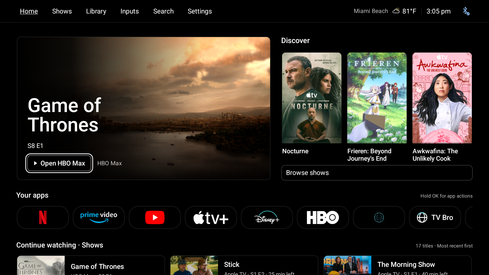
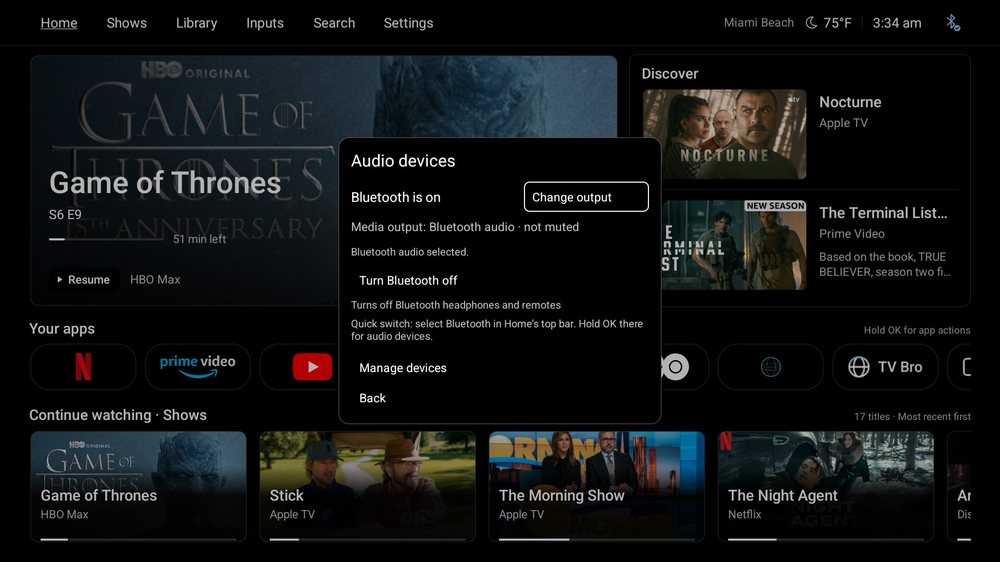
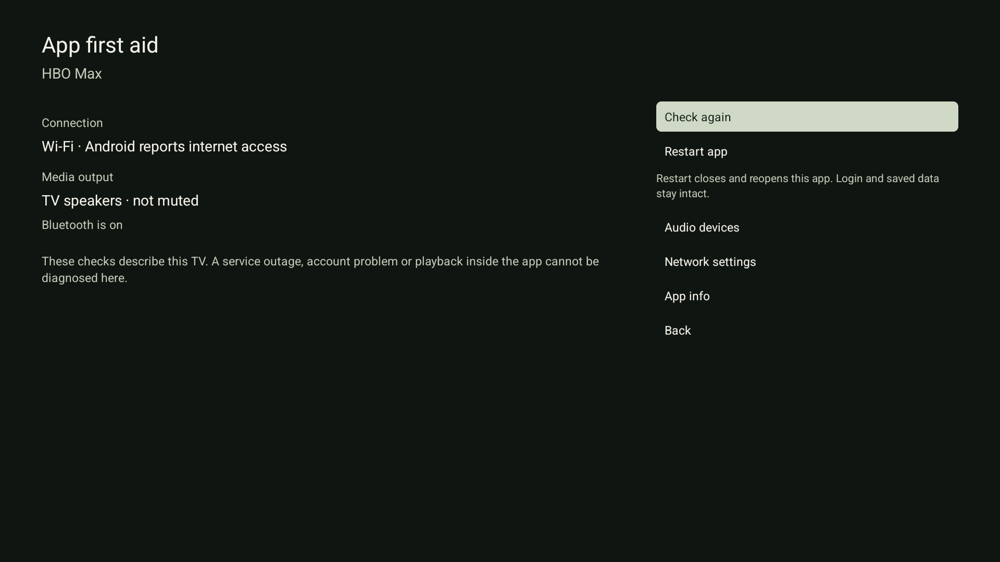
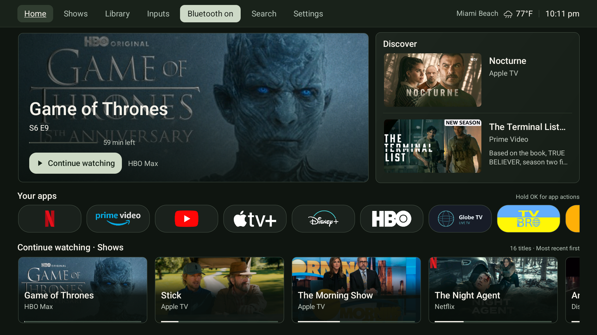
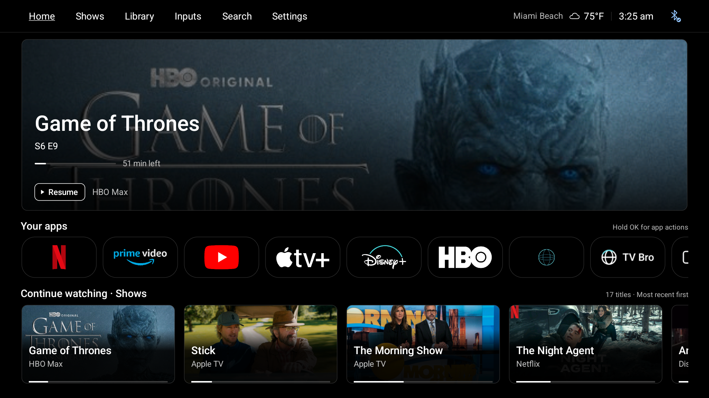
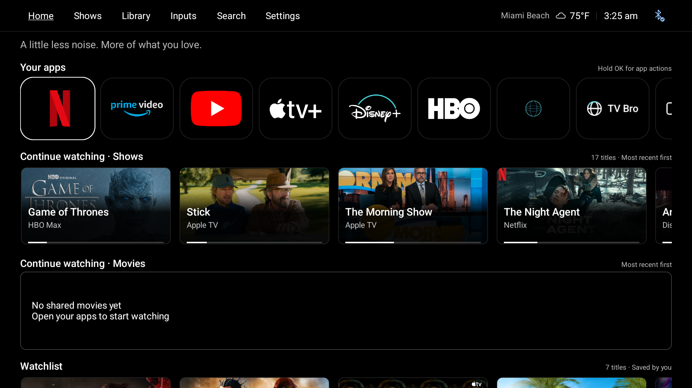
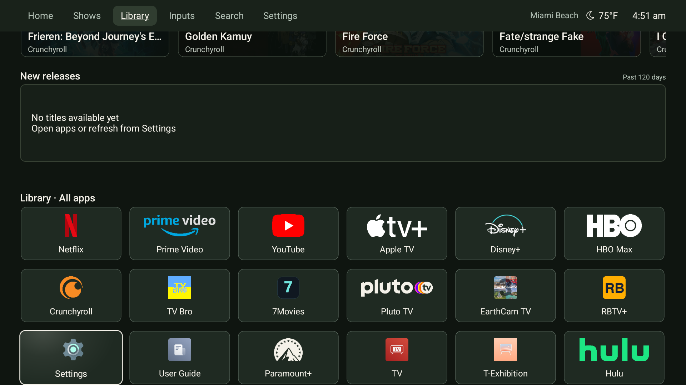
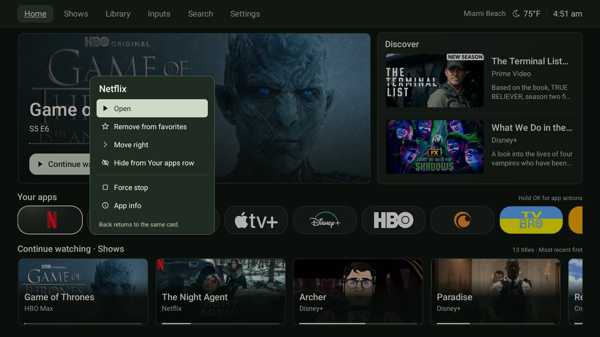

# prettTV

**A quieter home for Android TV.** Your apps, recent viewing and something new to watch, in three native layouts built for a remote.

[**Download**](https://github.com/draco1738/prettTV/releases/latest) · [Install](#install-pretttv) · [Layouts](#three-layouts-one-home) · [User guide](docs/usage.md) · [Documentation](docs/README.md)

[](https://github.com/draco1738/prettTV/releases/latest) [](https://github.com/draco1738/prettTV/actions/workflows/build.yml) [](LICENSE)



*C · Balanced 0.6.3 installed on the TCL TV, using actual available feeds. Three larger portraits sit beside the resume feature without changing the black theme or app row. A/B and Audio devices below retain their 0.5.1 captures; other images retain their stated historical versions. All are unedited device screenshots.*

## Make Home yours

**Staged for 0.6.5:** a calmer Balanced Home with smaller hero controls, one Shuffle action, a finite app-row counter and direct All activity / This TV history filters. The redesigned Audio panel puts Bluetooth power and direct output choices together, marking only the verified selected route. These owner-approved changes are being prepared while the TV sleeps; device validation and installation remain pending. [Candidate scope and checks →](docs/oled-home-audio.md)

**New in 0.6.3:** larger Discover picture areas (240×360), consistent Standard/Larger sizing across prettTV, direct session Undo, truthful recommendation explanations and Not interested controls, and explicit on-TV settings backup/restore. Startup reliability now has full-repository and real Android slow-transport coverage. **529 JVM tests and 184 isolated Android checks passed**; detailed evidence and limits are in [Validation](docs/validation.md). [Controls and backup →](docs/usage.md#interface-size-undo-and-recommendations)

**New in 0.6.1:** the three Discover cards beside the large feature now fill their frames proportionally. C can fetch genuine portrait artwork for exact series matches, instead of displaying landscape banners with empty bands. Artwork stays separate from progress and launch destinations, preferred-service tiers remain intact, and A/B are unchanged. [Appearance, controls, verified screenshots and limits →](docs/balanced-home.md)

**New in 0.6.0:** C Balanced adopts the approved split composition: a larger resume feature, three portrait discovery picks and **Browse shows**, followed by the familiar single app row and compact Continue watching cards. It uses real provider artwork and progress, preserves row preferences, and leaves Cinema and Quiet available. [Native design and controls →](docs/balanced-home.md)

**New in 0.5.2:** long discovery shelves keep every title while creating fewer live cards. Home prioritizes visible icons, shares duplicate image requests and releases artwork after extended time in another app. **Settings → Home & apps → Focus motion** adds an optional smaller lift with still artwork; Classic remains the default. [How the lighter Home works →](docs/lightweight-home.md)

**New in 0.5.1:** OLED-black cards, dialogs and buttons, white text and thin white focus outlines. A compact **Resume** action keeps the feature uncluttered. Streaming logos retain their color accents; TV Bro, RBTV+ and utility apps use original line icons and plain names without bright background blocks. Existing app-tile caches refresh automatically.

**Change output**, beside the Bluetooth status, selects TV speakers, Bluetooth audio or HDMI ARC on supported TCL firmware without turning the radio off. This theme covers prettTV; streaming apps and system screens retain their own appearance. [Validation and limits →](docs/validation.md)



**Owner's current TV setup:** Google TV's launcher and fallback launcher are disabled, and Home opens prettTV directly. The default ambient screensaver remains available. This choice gives up Google's voice-result screens and its gear-button dashboard; native TV controls are available through **prettTV Settings → TV & audio → TV settings**. The installer does not disable other launchers automatically. [Configuration details →](docs/browser-and-voice.md#preserve-pretttv-as-home)

**New in 0.5.0:** hold OK on an app for **App first aid**: check this TV’s connection and selected media output, then confirm a restart if needed. Logins and saved data stay intact. Search keeps its query and results together, Settings is grouped into four sections, and apps without a curated logo use their installed icon on a dark tile. [First aid and controls →](docs/usage.md#app-first-aid)



- **Return to your viewing.** A large resume feature in Cinema and Balanced follows the latest eligible viewing record. Separate Shows and Movies rows bring recent progress forward, with episode details and remaining time when an app supplies them.
- **Keep every app within reach.** A single finite Your apps row has a clear beginning and end, rounded dark cards and color accents. Arrange favorites or hide a shortcut from this row while keeping it in Library.
- **Find something worth watching.** Suggestions, Discover, Trending and New releases offer up to 60 titles per row. Choose the services to prioritize, hide shared-account titles and dismiss recommendations you do not want.
- **Save and follow.** Keep a dedicated local Watchlist, follow identifiable shows for new-episode alerts, and undo supported recent changes.
- **Choose your own layout.** Cinema, Quiet and Balanced share persistent Home, Shows, Library, Inputs, Search and Settings navigation. Optional location, weather and time sit together at the top right.
- **Move without losing your place.** Thin white outlines track focus. The new Balanced cards keep artwork still; other card styles retain the Classic/Quiet motion choice. Selected-title details occupy reserved space; refreshes retain usable content and artwork, and app actions return to the originating card.

Open **Settings → Home & apps → Customize rows** to reorder or hide content sections, choose card sizes, and set discovery limits to **20, 40 or 60**. The default order is:

**Continue watching · Shows → Continue watching · Movies → Watchlist → New episodes when available → Live sports → Suggestions → Discover → Trending → New releases.**

Library remains below the content rows. [Explore all controls →](docs/usage.md)

**New in 0.4.1:** faster returns to Home, repaired TCL app shortcuts and an **Inputs → Audio devices** panel with Bluetooth on/off and **Manage devices**. Direct switching uses an existing authorized local recovery connection and checks the resulting state; without that setup, use the TV's own controls. Turning Bluetooth off disconnects Bluetooth headphones and remotes. [Audio controls →](docs/usage.md#inputs-and-audio-devices)

**New in 0.4.3:** a **Bluetooth on/off** button in the top bar switches the radio with one OK press. Hold OK for Audio devices. It works without the optional remote helper, so the tested TCL can retain normal press-and-hold volume adjustment. Pending operations keep focus and ignore repeated clicks. The existing authorized local control connection is required; the native device-settings fallback remains available.



The optional [Remote buttons helper](docs/usage.md#remote-buttons) retains global app remaps and double-Mute Bluetooth control for users who enable it. **On the tested TCL, its key filtering stops held volume buttons from repeating.** The owner's setup now leaves this helper off and uses the top-bar switch instead. With it off, global custom app/Settings remaps and double-Mute are inactive. Neither an app update nor the installer enables the helper automatically.

**0.4.2 adds speaker handoff:** Bluetooth off selects the TV speakers on supported TCL firmware and preserves their saved volume. **Enable shortcut messages** in Audio devices allows the result to appear over other apps on Android 13+ when permission is needed. [Bluetooth and output behavior →](docs/usage.md#inputs-and-audio-devices)

**New in 0.4.4:** optional **Home compatibility** keeps prettTV visible on TVs that give Google Home priority, while Google's package remains available for Gemini voice results. It observes stock Home window names only; it cannot filter keys or read screen content. Voice results and settings remain open, and the double-confirmed stock restore pauses the redirect. Enable it through **Settings → Support → Home compatibility settings** only when needed. [Voice setup and limits →](docs/browser-and-voice.md#preserve-pretttv-as-home)

## Three layouts, one Home

**New in 0.4.5:** the Bluetooth on/off quick switch sits at the far right of the top bar, after weather and time. Its OK/hold-OK actions are unchanged.

**New in 0.4.6:** that switch uses a compact Bluetooth symbol: blue with a check for on, a muted slash for off, dots while checking/changing, and a question mark when unavailable. The state describes the radio, not a connected headphone. Full spoken labels and the existing OK/hold-OK actions remain available.

Switch through **prettTV Settings → Home & apps → Layout**. Apps, saved titles, viewing records and row preferences are shared across layouts.

| Layout | What leads the screen |
| :--- | :--- |
| **A · Cinema** | A wide feature, followed by apps and content rows. |
| **B · Quiet** | Apps first, followed by content rows. |
| **C · Balanced** | A large resume feature beside three portrait picks, one app row and compact continuation cards. **Default.** |

<details>
<summary><strong>A · Cinema</strong></summary>



</details>

<details>
<summary><strong>B · Quiet</strong></summary>



</details>

<details>
<summary><strong>Navigation that stays visible</strong></summary>

The opaque top bar stays in place as content scrolls. Left and Right stop at row boundaries; Up from the first content card reaches navigation.



</details>

<details>
<summary><strong>App actions, right beside the selected card</strong></summary>

Hold OK to open, arrange or hide a shortcut, inspect App info, or request Force stop. Open is selected first; Force stop has its own Cancel-first confirmation.



</details>

## Install prettTV

You need **Android TV 8.0 / API 26 or newer**, a computer with Android platform-tools (`adb`), and a debugging connection authorized on the TV. The release bundle needs no build tools.

1. Download **`prettTV-<version>-with-RBTV.zip`** from [GitHub Releases](https://github.com/draco1738/prettTV/releases/latest) and extract it.
2. Run `adb devices`, then use an entry listed as `device` in the command below. Run it from the extracted folder.
3. Allow **TV listings** when prettTV asks. Open **Settings → Support → Choose default Home app** and select prettTV in Android's settings.

**Windows · PowerShell**

```powershell
.\install.ps1 -Tv 'TV_SERIAL_FROM_ADB_DEVICES'
```

**macOS / Linux · Bash**

```sh
TV='TV_SERIAL_FROM_ADB_DEVICES' bash ./install.sh
```

The default bundle includes **RBTV+ 3.0.320**. The installer verifies the pinned companion checksum before a fresh installation and preserves any existing RBTV installation and its data. To skip the companion, add **`-LauncherOnly`** in PowerShell or **`--launcher-only`** in Bash. The standalone prettTV APK installs only the launcher.

The installers keep other launchers in place and leave Home selection and optional special access to you. RBTV is separate third-party software with its own terms and permissions; prettTV's MIT license does not cover it.

[Installation and connection help](docs/installation.md) · [RBTV provenance and limits](docs/companion-apps.md)

**Optional website apps:** [Globe TV](launcher/globetv/README.md) and [7Movies](launcher/webshortcut/README.md) add separate dark tiles that open their websites in TV Bro. They use your existing browser sessions and filtering, and are installed separately from prettTV.

### Already using prettTV?

Open **Settings → Support → Updates** to check release notes, download and install a newer official build. The updater verifies the APK's package, version, checksum and signing certificate before Android asks for installation confirmation. Compatible signed upgrades preserve settings; updating prettTV does not update RBTV.

Use the signed APK from [Releases](https://github.com/draco1738/prettTV/releases/latest) for an in-place release update. Ordinary source builds and GitHub CI artifacts use debug certificates and cannot replace a differently signed installation. [Update and signing details →](docs/installation.md#updates)

## Just a remote

| Control | Action |
| :--- | :--- |
| **Arrows / OK** | Move between cards / open the selected item. |
| **Hold OK on an app** | Open its action panel: launch, arrange, hide from Your apps, Force stop or App info, as applicable. |
| **Hold OK on a title** | View details, save, follow, hide, dismiss or correct recent viewing, as applicable. |
| **Left / Right at a row boundary** | Stop at the beginning or end; rows do not wrap. |
| **Up from the first content card** | Reach the persistent navigation bar. |
| **Down from navigation** | Return to the remembered content card. |
| **Home** | Reset the page and horizontal rows to their default start. |
| **Back** | Close the current panel or return content to the top. |
| **Menu** | Open prettTV Settings. |

Hiding an app from **Your apps** does not remove it from Library. Hiding a title from the hero or Continue watching stays local to this TV and does not change anyone else's streaming account. [App and title controls →](docs/usage.md)

## Viewing history, Watchlist and discovery

prettTV uses program rows that apps publish to Android TV, supported playback evidence and explicit local corrections. It does not ask for streaming credentials or have access to a universal account-wide viewing history.

Meaningful progress and episode changes can move a title forward; timestamp-only refreshes do not. Continue watching applies new ordering while keeping the selected title focused, and the hero follows the newest eligible record. Delayed or shared-account updates cannot establish exactly when or who watched. If a record is stale, hold OK and choose **I watched this most recently**.

**Watchlist is local to prettTV. It does not synchronize with Google account / Google TV Watchlist.** Hold OK on a title to save it. Supported confirmed playback can remove a started title, with Undo available; a provider progress observation alone does not consume a saved entry.

Choose **Settings → Shows & recommendations → Recommendation services** to prioritize your services explicitly, or use inference from shared viewing activity. Android does not reliably expose which streaming accounts are signed in. Provider coverage, subscriptions and regional availability vary; a listed title does not guarantee playback.

[Content sources and ordering](docs/content-and-sports.md) · [Watchlist and episode follows](docs/usage.md#save-titles-to-watchlist)

## More to explore

| Feature | How it works |
| :--- | :--- |
| **Blind Pick** | Reveal mystery movie/show choices filtered by type, mood and available runtime. Open a result or save it. |
| **Rabbit Hole** | Explore published cast/director, genre and release connections from a starting title. Missing metadata stays unavailable. |
| **Live sports** | Browse live/upcoming fixtures, prioritize favorite teams and enable optional Home-only kickoff reminders. The optional RBTV helper matches supported games and leaves server selection to you. |
| **Weather** | Enter a US ZIP and choose °F or °C. Nearby NWS observations appear beside the clock; freshness remains in Weather details. No GPS permission is needed. |
| **Offline Home** | Reuse recent content and available artwork during outages, with age/error information and expiry rules. Streaming still needs the app's connection. |
| **EarthCam idle handoff** | Optionally open the separately installed EarthCamTV app when Android starts the selected screensaver. EarthCam owns camera playback. |

**Blind Pick and Rabbit Hole live at the bottom of Library**, after installed apps. They are built into prettTV and stay out of the upper Your apps row. EarthCam and other optional apps are not part of the release bundle.

The owner's TCL now uses its stock screensaver, and EarthCam has been removed at their request. The optional EarthCam handoff remains available for other installations; upgrading prettTV does not select it automatically.

[Original Library experiences](docs/original-apps.md) · [Sports handoff](docs/content-and-sports.md) · [Weather](docs/usage.md#weather-beside-the-clock) · [EarthCam](docs/earthcam-idle.md)

## Troubleshooting and recovery

**Restart one app:** Hold OK on an eligible app → **Force stop** → confirm. After a verified stop, choose **Done** or **Open app**. Saved data and logins are kept. Direct stopping requires the existing authorized TV-local recovery connection; **App info** provides Android's controls when that setup is unavailable. Home and essential TV services are protected. This closes an app's connections; it does not reset the TV network or guarantee a fix for playback problems.

**Repair remote shortcuts:** The optional Remote buttons helper opens TCL's native quick-settings panel and routes supported branded app buttons to their documented destinations. Other manufacturers use standard Android Settings. Its Accessibility key filter leaves unrelated buttons alone and does not read screen content. [Setup and limits →](docs/usage.md#remote-buttons)

**Return to stock:** The button at the bottom of prettTV Settings requires **two confirmations**. With the original private setup record and authorized local TCP debugging configured, it restores recorded TCL/Google app states, Private DNS and Google TV Home while retaining installed streaming apps, logins and prettTV. It is a troubleshooting restore, not a factory reset; a fresh install cannot reconstruct an unknown baseline.

[Configure stock recovery](docs/stock-recovery.md) · [Select another Home or uninstall](docs/installation.md#restore-or-uninstall)

## Privacy and implementation

prettTV uses **Kotlin and native Android Views/Canvas**, progressive artwork loading and bounded caches. Focus effects finish and settle instead of animating continuously. There is no third-party UI framework or analytics SDK.

Personalization and viewing records are stored locally. Catalog, artwork, weather and update requests contact their respective providers, which receive normal connection/request information. Optional playback, game-handoff and remote-button access is enabled separately in Android settings. prettTV does not remove advertising inside other apps, and its privacy statements do not cover those apps.

[Privacy, stored data and optional permissions →](docs/privacy.md)

## Build, verify and contribute

Use **JDK 17**, **Android SDK platform 34**, **build-tools 35.0.0** and the included Gradle wrapper. See [Development](docs/development.md) for build commands, signing and the source map; [Stability testing](docs/stability-testing.md) describes isolated device checks.

The **0.4.4** build passed **407 JVM tests** and **seven targeted Android checks**, with **zero lint errors and 28 warnings**. The signed installed APK matched its release artifact. Google movie details and Gemini responses loaded through text requests to the assistant; Home returned to prettTV with key filtering off. Fresh physical microphone/volume confirmation remains pending. [0.4.4 scope and evidence →](docs/validation.md#pretttv-044-google-voice-results-with-native-volume--2026-11-03)

The preceding **0.4.3** quick-switch build has the following recorded results:

| Check | Result |
| :--- | :--- |
| JVM tests | **407 passed** across 34 suites. |
| Targeted Android checks on the TCL TV | **18 passed**, covering Bluetooth controls, panel return, Inputs, Home focus/navigation and normal/enlarged text in A/B/C. |
| Live quick switch | Both directions verified; Off selected TV speakers and On restored the previously owned Bluetooth output. Separate saved volumes were preserved. |
| Native volume | The owner confirmed continuous holds with the remote helper off; key filtering stayed off after the signed upgrade. |
| Android lint | **0 errors**, 32 existing warnings. |
| Installed release artifact | Pulled back from the TV and matched to the signed release SHA-256. |
| GitHub build | [Build workflow and commit-specific results](https://github.com/draco1738/prettTV/actions/workflows/build.yml). |

These are bounded release checks. The historical one-hour soak and full discovery suite were **not repeated for 0.4.3**; no universal app coverage or sustained frame-rate guarantee is implied. Speaker routing was verified through Android's state, not an audible listening test. Global custom remote shortcuts are intentionally off on the owner's TV. CI builds the Android test APKs but does not run them on a TV. [Full versioned evidence →](docs/validation.md)

For a bug report, include the prettTV version, TV model/Android version, layout, reproduction steps and expected behavior. Keep account details, private recovery records and raw preference exports out of public issues. For contributions, describe the behavior changed and the checks actually run; preserve existing source and asset attribution.

[Report an issue](https://github.com/draco1738/prettTV/issues) · [Source](launcher/app/src/main) · [Tests](launcher/app/src/test) · [Design reference](DESIGN.md)

## Built with credit

prettTV is derived from **[Rivi v0.15 by Jommi](https://github.com/jommi9/rivi)**, Copyright © 2026 Jommi, under the [MIT License](LICENSE). Rivi supplied the native Android foundation, app discovery/caching and remote-navigation patterns. Its original notices, source history and [upstream README](docs/upstream-rivi-readme.md) are retained.

**[PLUI by Smartago](https://github.com/smartago/plui-tv-launcher)** and stock Google TV informed the design. Their implementations and artwork are not redistributed. App icons, catalog data, show artwork and companion software retain their own rights and licenses.

[Full credits and third-party notices](THIRD_PARTY_NOTICES.md) · [App-icon sources](launcher/app/src/main/assets/app-icons/sources.json) · [Documentation index](docs/README.md)
