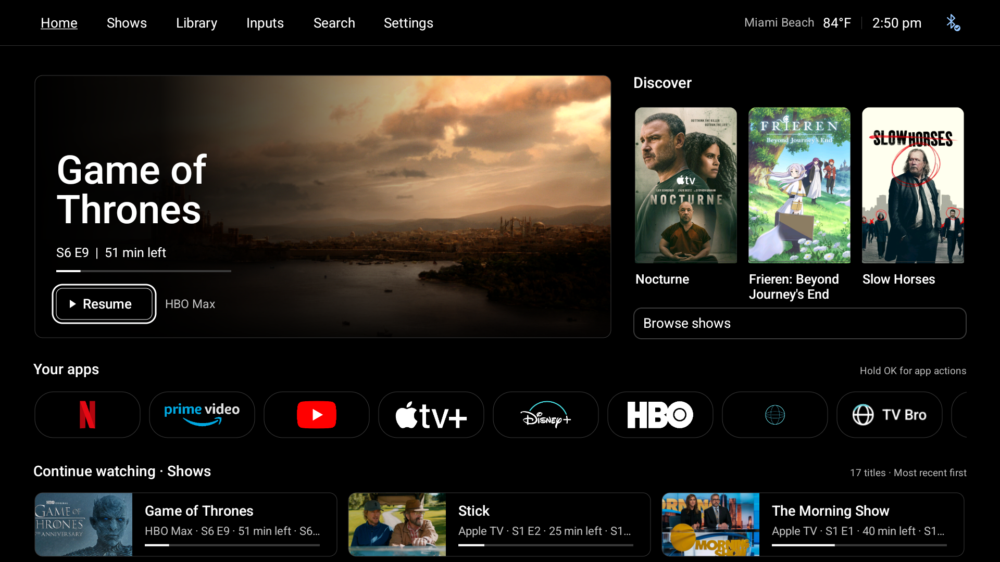
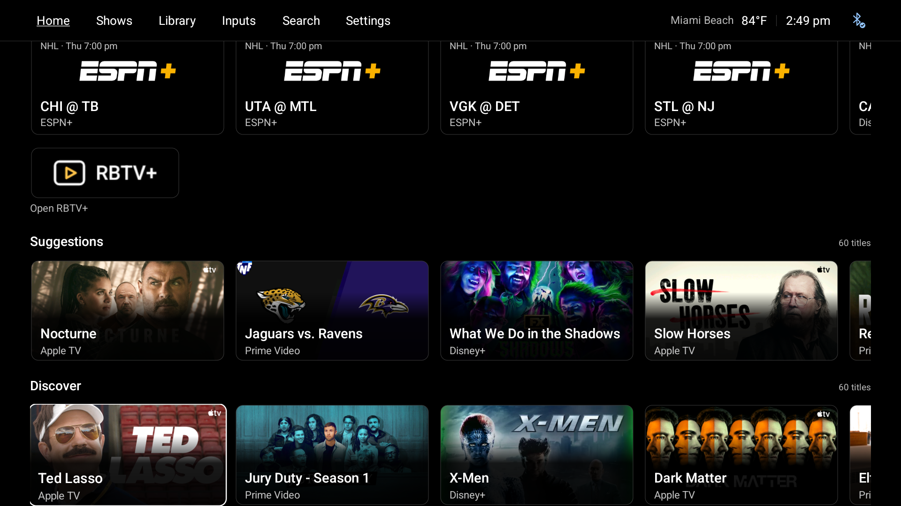

# C Balanced: resume, discover, open

[← prettTV](../README.md) · [User guide](usage.md) · [Validation](validation.md)

Version 0.6.0 introduced the owner's selected C concept as native Android Views and Canvas. Version 0.6.1 corrects the artwork mismatch: genuine portrait metadata for eligible discovery titles, proportional full-frame drawing, and a clean feature backdrop when a verified match supplies one. This is not a WebView, a static mockup, or a new catalog. Cinema and Quiet remain available through **Settings → Home & apps → Layout**.

*Actual, unedited TV capture. Nocturne, Frieren: Beyond Journey's End and Slow Horses use verified 2:3 portraits. The Game of Thrones feature has a matching clean background. Titles, episode information, progress and launch destinations come from the TV, not from the concept's sample content.*

## What changed

### Home interface size · 0.6.2

The 0.6.2 update adds **Settings → Home & apps → Home interface size**. **Standard · 100%** keeps the v0.6.1 geometry. **Larger · 104%** scales Home's cards, text, icons, gaps and controls together, using some of the outer margins so the hero and all three portraits still fit side by side. Lower shelves scroll; no screenshot or root-view bitmap is enlarged/cropped. Selection is retained when changing sizes, and the setting is included in local settings export/restore.

This controls Home, including its header and Library grid, not Android display density, other apps, system screens or every separate prettTV Activity/dialog. System text scaling remains independent. The modest limit is intentional: a larger uniform increase cannot keep this full-width composition on screen without cropping or restructuring it. Standard remains the default. The 0.6.2 build passed 474 JVM and 158 native checks and was installed with settings and the pulled-back APK verified. [Actual 0.6.2 Home](screenshots/C-balanced-0.6.2.png) · [Validation](validation.md). Images explicitly labeled 0.6.1 remain historical evidence.

The 0.6.2 update also corrects compact Continue watching binding: it combines the service with a deduplicated metadata/time line instead of appending that line to the original provider detail again. Only exact repeated fields are removed; unique descriptions and ambiguous episode labels are not guessed away. Original provider detail and synopsis remain available in title details, and other card modes keep their existing formatting.

### Approved v0.6.1 composition

A larger feature occupies the left of the first screen. Its two-line title, actual metadata, progress when supplied, dark Resume/Open action and service label remain distinct. The existing chronology and hidden-title policy choose the feature; a refresh timestamp does not become evidence of recent viewing.

Three portrait picks sit to the right of the large feature. C now considers a bounded six-title pool, preferring series and verified portraits within the existing service-priority tiers. Sports stay in their ordinary shelves rather than occupying these show-poster slots; duplicate titles and the feature are excluded. Optional exact-match TVmaze metadata supplies real portrait URLs instead of assuming that a provider's `poster_art_uri` is actually portrait-oriented. A short feed remains short, and an empty feed offers an honest route to apps. Artwork updates preserve the selected title where it remains available; removal and empty-state transitions recover usable focus.

**Browse shows** goes to an existing visible discovery shelf, without launching a provider or promising streaming availability. If those shelves are hidden, it returns to available content or apps.

The single Your apps row keeps its **208 × 94** reference-pixel cards, **36-pixel corners** and **12-pixel gaps**. Standard-size Continue watching rows use compact landscape-thumbnail cards with title and actual supplied metadata. Custom Small/Large choices, separate Shows/Movies shelves, ordering and hiding remain supported. Library, local Watchlist and the remaining rows stay below.

## What you see

**Top navigation.** Home, Shows, Library, Inputs, Search and Settings stay in one opaque horizontal bar. There is no sidebar. Existing optional location/weather, clock and Bluetooth status stay on the right. The bar remains visible when lower shelves scroll underneath it.

**The resume feature.** The largest area belongs to the next viewing action, with a two-line title, episode metadata when available, supplied remaining time and a restrained progress line. A dark overlay keeps the text readable over artwork. The compact outlined action says **Resume** only when supported progress exists; otherwise it opens the relevant app/title. The source label sits beside it. A stale or unavailable feed is not replaced with invented progress.

**Discovery.** Up to three tall frames sit alongside the feature, each with a 2:3 picture area and its title below. Series and verified portraits are preferred only within service tiers, so a fallback service cannot jump ahead of preferred-service content merely because it has a poster. Other provider titles can remain as fallbacks. These are recommendations, not proof of a subscription or playback entitlement.

**Artwork limits.** A provider field named “poster” can contain a wide banner; this caused the empty bands in 0.6.0. Version 0.6.1 prefers dimension-checked portrait artwork for an exact series match. Every poster frame now uses one scale for both axes and a centered crop, never independent stretching. If no verified portrait exists, the original provider image is cropped rather than flattened; this can omit the sides of a wide banner and is not equivalent to a genuine poster. Ambiguous titles, movies, untyped items and sports are not guessed into a TV series. Missing art keeps a usable title/action. No episode still or URL is fabricated.

**Apps and continuation.** Recognizable colored streaming marks remain on black rounded tiles. The first screen gives the hero and discovery breathing room while keeping Your apps and the start of Continue watching visible at normal text size. Continuation cards place a small landscape image beside the title, service/episode information and valid progress. Enlarged text can push lower shelves farther down the page; the screen scrolls rather than squeezing text into the same height.

## Remote behavior

- Right from the feature reaches the first available poster. Right stops at the last poster; Left returns through the posters to the feature.
- Down from a poster reaches Browse shows; Down again reaches Your apps.
- Up from the first-stage content reaches the permanent top navigation. Down from navigation returns to remembered content.
- Home resets navigation and row positions without discarding the unchanged native hierarchy. Hold OK retains the existing title/app actions.

OK on the feature or a program follows its existing launch destination. OK on an app opens that app. **Browse shows** only moves focus into Home's existing discovery shelves; it does not start playback. Hold OK on a title still opens details and the applicable save, follow, hide, dismiss or viewing-order correction actions. Back closes panels or returns content toward the top. Menu opens Settings.

When a provider refresh removes the selected discovery item, focus stays within the replacement discovery area. Empty-to-populated transitions also select a usable replacement instead of an invisible old view. Lower windowed shelves still retain every configured title while mounting only nearby views.

<strong>See Browse shows on the installed TV</strong>

The existing row order is retained. This TV has sports above Suggestions and Discover; Browse shows moves to an available discovery shelf rather than rearranging those preferences.

## What remains unchanged

- A Cinema and B Quiet keep their own compositions. Selecting C does not replace the other layouts.
- App ordering, hidden shortcuts, row order/visibility/card-size choices, preferred services, weather, focus-motion preference and local title preferences remain supported.
- Continue watching uses existing chronology and explicit local corrections. It cannot identify who watched on a shared account or establish account-wide viewing history.
- Watchlist stays local. Following shows, recommendation feedback, original Library experiences and the existing sports features remain available.
- Audio controls, app first aid, native settings routes, updates and recovery controls are not redesigned or silently enabled.
- The update does not clear streaming-app data, change sign-ins, enable accessibility helpers, alter audio output or select a different default Home.

## Rendering and data

At 1920 × 1080 reference size, C has 64-pixel side insets, a 1112 × 510 feature, a 40-pixel gutter and a 640-pixel discovery column. The stage grows for enlarged system text rather than allowing poster labels to collide with Browse shows. Text is native sans, surfaces stay black, and focus uses white outlines. New feature/poster/continuation artwork stays still; there is no autoplay, blur, added background polling or new runtime UI dependency.

Original provider portrait metadata remains backward compatible with saved titles and offline snapshots. C's new presentation-only map does not overwrite those fields, viewing history, progress or destinations. With discovery enabled and a verified network, an optional TVmaze pass can send the visible title names or supplied IDs for at most six candidates and the feature. It permits eight metadata requests with a twelve-second network-work budget and independent connection-disconnect timer, delivers all normal feeds first, rejects stale-generation callbacks and retains a separate bounded cache. Cache I/O and platform transport cleanup mean this is not a strict end-to-end elapsed-time guarantee. A/B do not opt in. [Network disclosures and cache limits](privacy.md#c-balanced-presentation-artwork). Image bytes still use the bounded, prioritized loader introduced in 0.5.2.

The new native feature, poster and continuation modes use static focus outlines: no card scaling, spotlight, artwork drift or autoplay. Existing card modes retain their existing behavior, including the Classic/Quiet focus-motion choice. There is no added UI framework or production runtime dependency.

Portrait fields survive saved/followed titles, playback records, local settings transfer and offline data. New binary snapshots use version 2; version 1 snapshots remain readable with an empty optional poster field. Existing landscape art remains separate and unchanged for legacy layouts and shelves.

## Verification and credits

The corrected 0.6.1 candidate passed **458 JVM tests across 37 suites** and **156 isolated native Android checks** on the TCL, with **zero Android lint errors and 28 existing warnings**. Coverage includes proportional full-frame rendering, C geometry, artwork-only rebinding, selected-title focus retention, A/B/C, normal and enlarged text, service-tier preservation, matching/cache/budget limits and old-data compatibility. Repeated native runs and the scoped artwork harness overlap these totals rather than adding independent tests.

The signed **0.6.1 / code 30** APK was installed in place, pulled back and matched to the tested artifact. All three live Discover cards reported verified metadata bindings and decoded **250 × 375** portrait bitmaps. The feature reported a matching **960 × 540** background. Home, app and personalization settings matched the pre-install export except navigation focus; automatic playback observations were outside that comparison. Poster traversal, reversal, Browse shows and app-row boundaries passed without restarting Home. These are bounded device checks, not a new hour-long soak, a physical remote latency measurement or a streaming-playback benchmark. See [Validation history](validation.md) for the detailed evidence and limitations.

prettTV remains derived from **Rivi by Jommi**, with the original MIT notice retained. PLUI and Google TV remain design references, not copied proprietary implementations. Native app-logo assets, catalog data and provider artwork retain their respective credits and terms in [Third-party notices](../THIRD_PARTY_NOTICES.md).

The concept used illustrative content. The installed launcher uses the TV's actual available data, so titles, progress and services will differ. It does not infer subscriptions or add Google account Watchlist synchronization.
