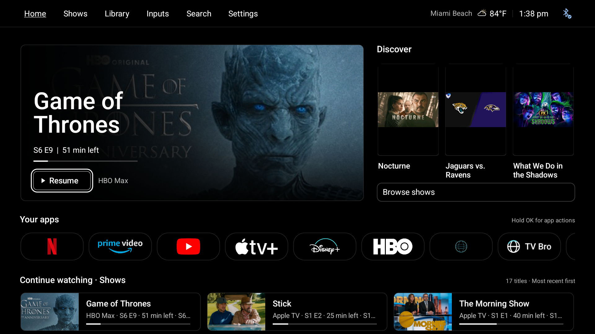
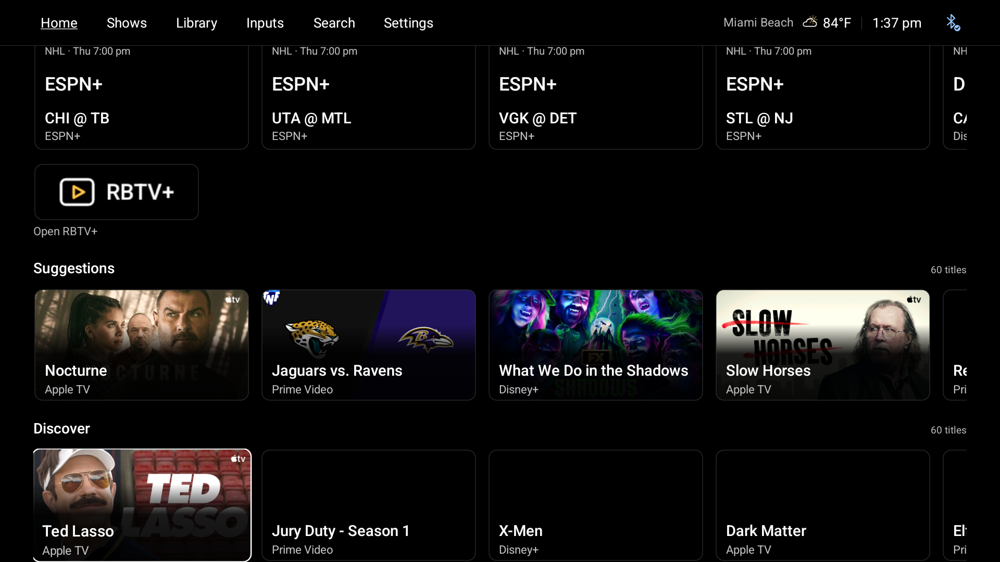

# C Balanced: resume, discover, open

[← prettTV](../README.md) · [User guide](usage.md) · [Validation](validation.md)

Version 0.6.0 implements the owner's selected C concept as native Android Views and Canvas. This is not a WebView, a static mockup, or a new catalog. Cinema and Quiet remain available through **Settings → Home & apps → Layout**.

*Actual, unedited TV capture. The composition follows the approved C concept; the titles and artwork come from the TV, not from the concept's sample content.*

## What changed

A larger feature occupies the left of the first screen. Its two-line title, actual metadata, progress when supplied, dark Resume/Open action and service label remain distinct. The existing chronology and hidden-title policy choose the feature; a refresh timestamp does not become evidence of recent viewing.

Three portrait picks replace the stacked discovery panel on the right. They use poster artwork supplied by the existing providers and catalogs. Landscape art remains available to other shelves; when no poster is provided, the portrait card contains the existing artwork rather than inventing or stretching it. The combined candidates retain the existing service and feedback priorities before the three-card limit; duplicate titles and the feature are excluded. A short feed remains short, and an empty feed offers an honest route to apps. When a refresh removes the focused poster or fills an empty panel, focus moves to an available replacement inside discovery.

**Browse shows** goes to an existing visible discovery shelf, without launching a provider or promising streaming availability. If those shelves are hidden, it returns to available content or apps.

The single Your apps row keeps its **208 × 94** reference-pixel cards, **36-pixel corners** and **12-pixel gaps**. Standard-size Continue watching rows use compact landscape-thumbnail cards with title and actual supplied metadata. Custom Small/Large choices, separate Shows/Movies shelves, ordering and hiding remain supported. Library, local Watchlist and the remaining rows stay below.

## What you see

**Top navigation.** Home, Shows, Library, Inputs, Search and Settings stay in one opaque horizontal bar. There is no sidebar. Existing optional location/weather, clock and Bluetooth status stay on the right. The bar remains visible when lower shelves scroll underneath it.

**The resume feature.** The largest area belongs to the next viewing action, with a two-line title, episode metadata when available, supplied remaining time and a restrained progress line. A dark overlay keeps the text readable over artwork. The compact outlined action says **Resume** only when supported progress exists; otherwise it opens the relevant app/title. The source label sits beside it. A stale or unavailable feed is not replaced with invented progress.

**Discovery.** Up to three tall frames sit alongside the feature. They can contain shows, movies or other programs published by the available providers. The combined selection keeps preferred-service, recency and feedback priorities, removes duplicates, and avoids repeating the feature. These are recommendations, not proof of a subscription or playback entitlement.

**Artwork limits.** A portrait frame is not a promise that its provider supplies a portrait. The installed capture above has wide images for all three recommendations, so they are contained with black space above and below. Portrait images fill the tall artwork slot when available. The launcher does not stretch a wide image, manufacture a poster URL, or replace it with unrelated artwork. Missing art keeps a usable title/action rather than a loading spinner indefinitely.

**Apps and continuation.** Recognizable colored streaming marks remain on black rounded tiles. The first screen gives the hero and discovery breathing room while keeping Your apps and the start of Continue watching visible at normal text size. Continuation cards place a small landscape image beside the title, service/episode information and valid progress. Enlarged text can push lower shelves farther down the page; the screen scrolls rather than squeezing text into the same height.

## Remote behavior

- Right from the feature reaches the first available poster. Right stops at the last poster; Left returns through the posters to the feature.
- Down from a poster reaches Browse shows; Down again reaches Your apps.
- Up from the first-stage content reaches the permanent top navigation. Down from navigation returns to remembered content.
- Home resets navigation and row positions without discarding the unchanged native hierarchy. Hold OK retains the existing title/app actions.

OK on the feature or a program follows its existing launch destination. OK on an app opens that app. **Browse shows** only moves focus into Home's existing discovery shelves; it does not start playback. Hold OK on a title still opens details and the applicable save, follow, hide, dismiss or viewing-order correction actions. Back closes panels or returns content toward the top. Menu opens Settings.

When a provider refresh removes the selected discovery item, focus stays within the replacement discovery area. Empty-to-populated transitions also select a usable replacement instead of an invisible old view. Lower windowed shelves still retain every configured title while mounting only nearby views.

<strong>See Browse shows on the installed TV</strong>

The existing row order is retained. This TV has sports above Suggestions and Discover; Browse shows moves to an available discovery shelf rather than rearranging those preferences.

## What remains unchanged

- A Cinema and B Quiet keep their own compositions. Selecting C does not replace the other layouts.
- App ordering, hidden shortcuts, row order/visibility/card-size choices, preferred services, weather, focus-motion preference and local title preferences remain supported.
- Continue watching uses existing chronology and explicit local corrections. It cannot identify who watched on a shared account or establish account-wide viewing history.
- Watchlist stays local. Following shows, recommendation feedback, original Library experiences and the existing sports features remain available.
- Audio controls, app first aid, native settings routes, updates and recovery controls are not redesigned or silently enabled.
- The update does not clear streaming-app data, change sign-ins, enable accessibility helpers, alter audio output or select a different default Home.

## Rendering and data

At 1920 × 1080 reference size, C has 64-pixel side insets, a 1112 × 510 feature, a 40-pixel gutter and a 640-pixel discovery column. The stage grows for enlarged system text rather than allowing poster labels to collide with Browse shows. Text is native sans, surfaces stay black, and focus uses white outlines. New feature/poster/continuation artwork stays still; there is no autoplay, blur, added background polling or new runtime UI dependency.

Portrait metadata is optional and backward compatible with existing saved titles and offline snapshots. It comes from responses already fetched by the application, not an additional network request. Artwork loading retains the bounded caches, shared requests and lifecycle cancellation introduced in 0.5.2.

The new native feature, poster and continuation modes use static focus outlines: no card scaling, spotlight, artwork drift or autoplay. Existing card modes retain their existing behavior, including the Classic/Quiet focus-motion choice. There is no added UI framework or production runtime dependency.

Portrait fields survive saved/followed titles, playback records, local settings transfer and offline data. New binary snapshots use version 2; version 1 snapshots remain readable with an empty optional poster field. Existing landscape art remains separate and unchanged for legacy layouts and shelves.

## Verification and credits

The complete candidate passed **433 JVM tests across 36 suites** and **154 isolated native Android checks** on the TCL, with **zero Android lint errors and 28 existing warnings**. Coverage includes A/B/C, normal and enlarged text, focus replacement, artwork fallback, existing service markers, long-row navigation, lifecycle handling and old-data compatibility. The earlier 70-check focused visual run overlaps the full suite; it is not an additional independent total.

The signed **0.6.0 / code 29** APK was installed in place, pulled back and matched to the tested artifact. Home, app and personalization settings matched the pre-install export except navigation focus; automatic playback observations were outside that comparison. These are bounded device checks, not a new hour-long soak, a physical remote latency measurement or a streaming-playback benchmark. See [Validation history](validation.md) for the detailed evidence and limitations.

prettTV remains derived from **Rivi by Jommi**, with the original MIT notice retained. PLUI and Google TV remain design references, not copied proprietary implementations. Native app-logo assets, catalog data and provider artwork retain their respective credits and terms in [Third-party notices](../THIRD_PARTY_NOTICES.md).

The concept used illustrative content. The installed launcher uses the TV's actual available data, so titles, progress and services will differ. It does not infer subscriptions or add Google account Watchlist synchronization.
