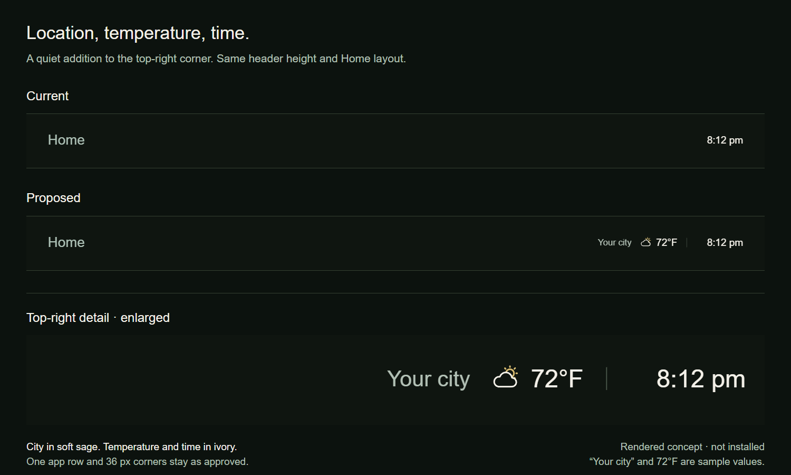

# Location and temperature beside the clock

[← prettTV](../../../README.md)

A rendered proposal for the top-right Home header. **Preview only; weather has not been implemented or installed.** The location, temperature, condition and time below are illustrative values, not live weather or the owner's location.

[Open the full-size comparison](comparison.png)

The proposal keeps the header at **56 reference pixels high** and preserves the current Home layout. Location uses muted sage at 23 reference pixels; temperature and time use ivory at 26. A small original condition icon adds a restrained warm accent. A thin divider separates weather from the clock. The user's approved single app row and 36-pixel corners remain unchanged.

The renderer verified the unchanged header height, contained clock, and long-city ellipsis with a negative Celsius temperature and 24-hour time. These are browser layout checks, not Android or network validation. The displayed location and units still need confirmation before implementation. A live version should preserve the TV's clock format and clearly handle unavailable or stale weather without displaying sample values.

The preview is original HTML/CSS/SVG using prettTV's established color and typography roles. It includes no private device data or third-party weather results.