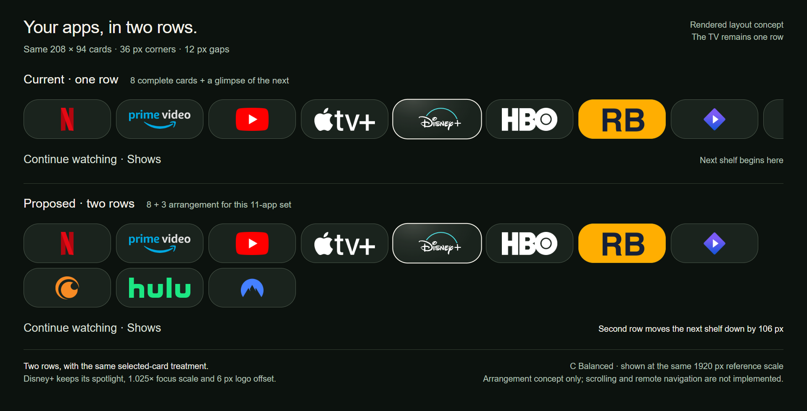

# Your apps in two rows

[← prettTV](../../../README.md) · [Approved 36-pixel corners](../rounder-36/README.md)

A rendered **two-row proposal**, compared with the current single row. **This layout has not been installed.** Version 0.2.2 retains one row with the approved 36-pixel corners.

[Open the full-size image](comparison.png)

The C Balanced concept keeps **208 × 94** cards, **36-pixel corners** and **12-pixel gaps**. The 1808-reference-pixel shelf currently shows eight complete cards and 48 pixels of the next card. The proposal arranges this 11-app set as **eight above and three below**, placing Continue watching **106 reference pixels lower**. Values are scaled from a 1920-wide reference surface.

Disney+ retains the same spotlight, 1.025× focus scale and six-pixel artwork offset. This is a browser-rendered arrangement concept, not a native TV screenshot or a test of scrolling, remote navigation or performance. Native behavior and layouts A/B would need implementation after approval.

App marks reuse the existing prettTV icon assets: [Homarr Dashboard Icons](https://github.com/homarr-labs/dashboard-icons) under [Apache-2.0](../../../launcher/app/src/main/assets/app-icons/LICENSE.txt), with provenance in the [source manifest](../../../launcher/app/src/main/assets/app-icons/sources.json). Disney+ uses the existing adapted vector. RBTV+ artwork comes from the existing companion app's launcher asset; its name and mark belong to its owner. Other brands and marks belong to their respective owners. No private settings export, account data, viewing history or playback links are included.