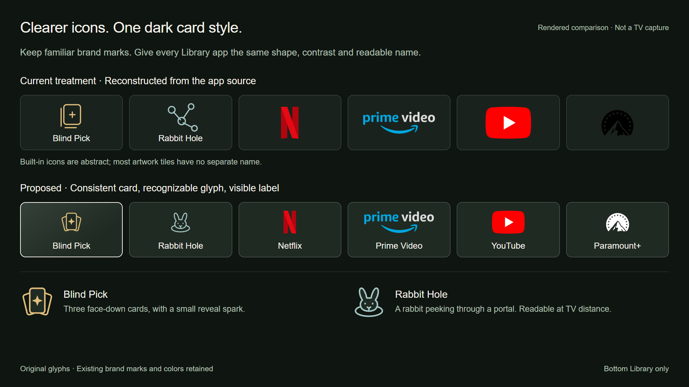
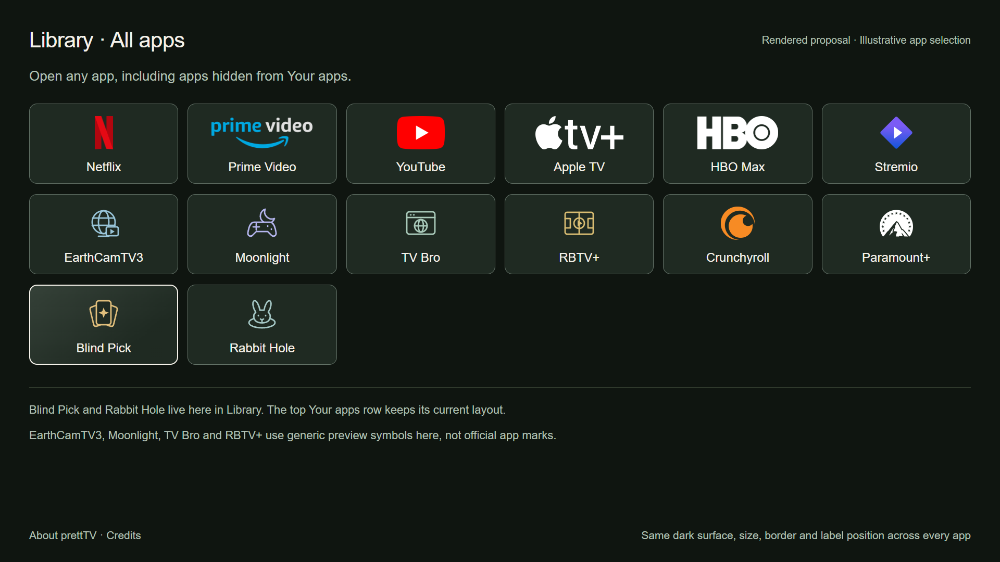

# Library glyphs and card consistency

[← prettTV](../../../README.md) · [Original apps proposals](../original-apps/README.md)

**Rendered mockups, not TV captures.** The upper comparison row is reconstructed from current source; the proposed lower row and Library screen show a refinement of the same prettTV visual system. The app selection is illustrative, not a current device inventory.

## Proposed changes

- Use one **#1F2A22** dark card ground across the bottom Library, with **#647368** quiet but visible edges. Keep the existing 15-pixel corners, six columns, 154-pixel height and 18-pixel horizontal gaps.
- Keep real app logos and their existing color accents. Contain them in a shared visual area, up to 194 × 64 reference pixels; never stretch a wordmark or crop a logo to force identical shapes.
- Render the existing **monochrome Paramount mark in ivory** on the dark card. Its `paramount-plus-light.png` filename is misleading: the current asset's visible mark is black. The proposal preserves that exact silhouette and changes only its single color for contrast. This does not authorize recoloring arbitrary full-color logos.
- Give every app a separate ivory **24-pixel label** in the same position. Long labels should ellipsize visually and retain their full accessibility description.
- Use an ivory focus outline and the existing finite spotlight. The focused card must remain recognizable when artwork is dark or missing.
- Replace Blind Pick's abstract plus/card with **three face-down cards and a reveal spark**.
- Replace Rabbit Hole's generic node graph with **a rabbit emerging from a portal**.
- Keep original destinations out of the top Your apps row. This proposal changes the bottom Library only.

The new glyphs are original SVGs: [Blind Pick](blind-pick.svg) and [Rabbit Hole](rabbit-hole.svg). Native implementation can reproduce these few paths with Canvas once per cached tile; no vector library or continuous animation is required.

## Source findings

`PrettTvCard.Mode.APP` currently samples each bitmap for the card background and uses a shader over the tile. The separate app title is drawn only when artwork is absent. `AppIconPack` composes mapped logos on a consistent dark background, but `AppRepository.render` can fill unmapped tiles with an installed-app banner. That produces inconsistent surface color and often leaves unfamiliar apps identifiable only by their banner.

A dedicated Library rendering mode or explicit Library flag should reserve a logo area and a text baseline. It should use a constant ground, contain the known app mark, and retain the existing top app-row behavior. Prefer an installed app icon over a full photographic banner for unmapped Library entries, retaining its original artwork within the bounded logo area. Do not blindly recolor arbitrary brand artwork. Keep a visible initials or app-name fallback when an icon fails to decode.

The proposed edges and label contrast were checked against the pictured surfaces. Browser font metrics remain an approximation of Android's system sans-serif; native font scaling, long names, focus clipping and fallback icons need device verification before claiming parity.

## Provenance

The two original glyphs are authored in this folder. EarthCamTV3, Moonlight, TV Bro and RBTV+ are shown with explicitly labeled, original **generic preview symbols**, not invented official logos; a shipped implementation should use their actual installed app icon or an attributed official asset when available. Other brand marks reuse the existing [Homarr Dashboard Icons](https://github.com/homarr-labs/dashboard-icons) assets under the repository's [Apache-2.0 license](../../../launcher/app/src/main/assets/app-icons/LICENSE.txt); exact asset provenance is in the [source manifest](../../../launcher/app/src/main/assets/app-icons/sources.json). App names and marks remain owned by their respective owners.

The HTML is an offline design review, not a shipped app screen. No TV state, Kotlin source or GitHub content was changed to create this proposal.
