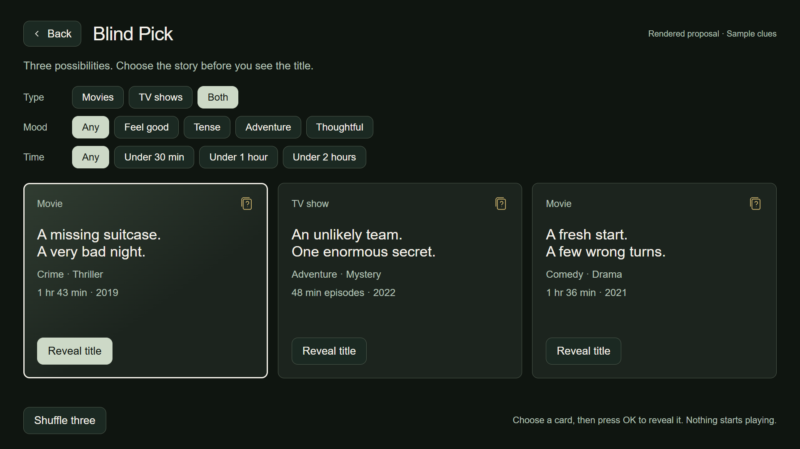
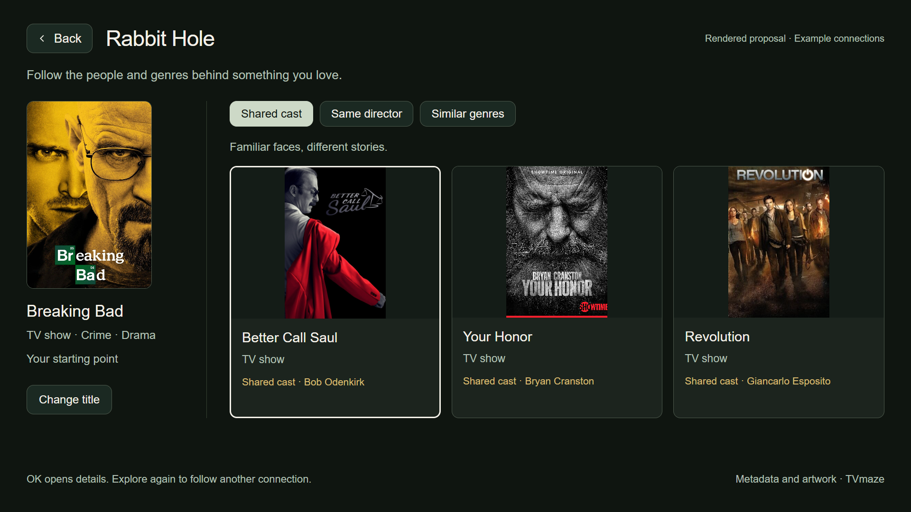
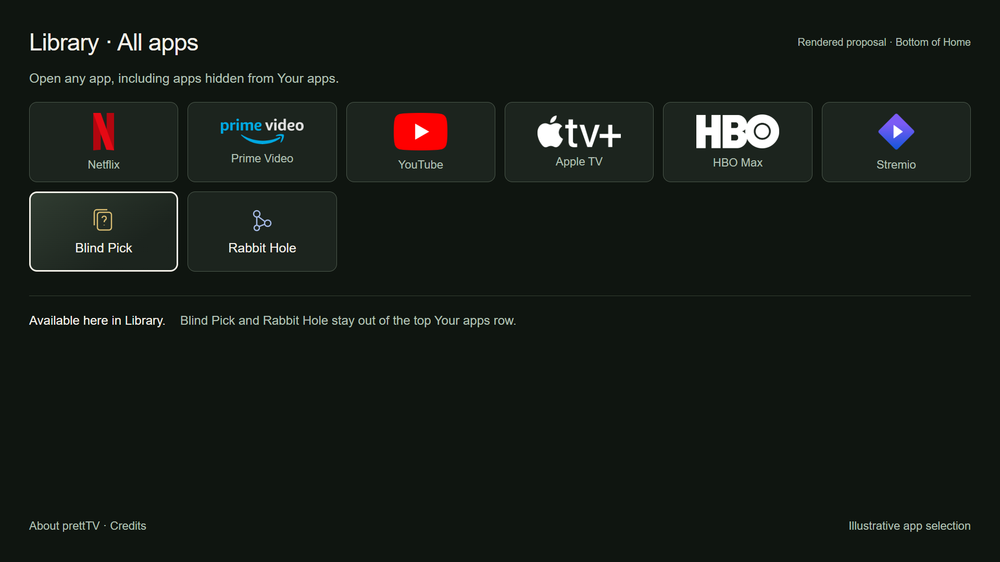

# Blind Pick and Rabbit Hole

[← prettTV](../../../README.md)

**Rendered proposals, not captures from the TV.** These screens extend prettTV's existing sage-black surfaces, ivory focus, system sans-serif and quiet card edges. All three previews are 1920 × 1080. The owner has requested the two tools in the bottom Library, outside the top Your apps row.

## Blind Pick



Movies, TV shows or both; a mood; and time available narrow the selection. Three cards hide the title and artwork until **Reveal title**. Runtime for a show means one episode. The pictured clues, years and runtimes are synthetic examples of layout only; they are not catalog entries or recommendations.

Reveal should expose the real title, artwork and known destinations without starting playback. **Shuffle three** replaces this batch only. Loading should retain the filters and show “Finding three picks…” without animated decoration. An insufficient catalog should show the available matches, rather than duplicate titles. No matches should offer **Clear filters**; a network failure should offer **Try again** and preserve valid cached results when available.

The real implementation should use source metadata, omit unknown runtime from time-limited results, avoid spoilers and hidden titles, and favor the owner's selected services without claiming to know login status.

## Rabbit Hole



Choose a title, then browse **Shared cast**, **Same director**, or **Similar genres**. Every card names the connection. A card opens details and can become the next starting point. Back should retrace the exploration, then return to Library with focus retained.

The displayed shared-cast examples were checked against TVmaze cast data: Breaking Bad and Better Call Saul share Bob Odenkirk; Breaking Bad and Your Honor share Bryan Cranston; Breaking Bad and Revolution share Giancarlo Esposito. These are examples, not the owner's viewing history or a claim about streaming availability. Unverified or missing cast/director metadata must yield an honest empty state, not an invented relationship. Loading, error and empty states keep the seed and relationship controls accessible.

## Bottom Library placement



The two original icons use warm gold and pale blue accents inside the existing dark card language. The top app row stays unchanged. Other apps shown here are an illustrative selection, not a current device inventory.

## Rendering and provenance

`index.html` is a static design review, not a shipped implementation. `render.mjs` uses an already installed Chromium executable and a temporary browser profile on E:. No runtime web UI, downloaded font or animation dependency is proposed for the TV. The render uses Arial as a browser stand-in for Android's native system sans-serif, so native text metrics still need verification.

```powershell
$env:CHROME = 'C:\Program Files\Google\Chrome\Application\chrome.exe'
$env:PREVIEW_TEMP = 'E:\Development\tcl-tv-tools\temp'
node .\docs\previews\original-apps\render.mjs
```

Poster images are sourced from [TVmaze](https://www.tvmaze.com/), with exact URLs in [assets/sources.json](assets/sources.json). Metadata follows the [TVmaze API attribution terms](https://www.tvmaze.com/api#licensing). Poster copyrights remain with their respective owners; the images are used only to illustrate the proposed discovery interface. Cast references: [Breaking Bad](https://api.tvmaze.com/shows/169/cast), [Better Call Saul](https://api.tvmaze.com/shows/618/cast), [Your Honor](https://api.tvmaze.com/shows/32791/cast), and [Revolution](https://api.tvmaze.com/shows/237/cast).

Existing app marks reuse the repository's Homarr Dashboard Icons assets and retain their [Apache-2.0 license](../../../launcher/app/src/main/assets/app-icons/LICENSE.txt) and [source manifest](../../../launcher/app/src/main/assets/app-icons/sources.json). The Blind Pick and Rabbit Hole icons are original SVG drawings in `index.html`.
