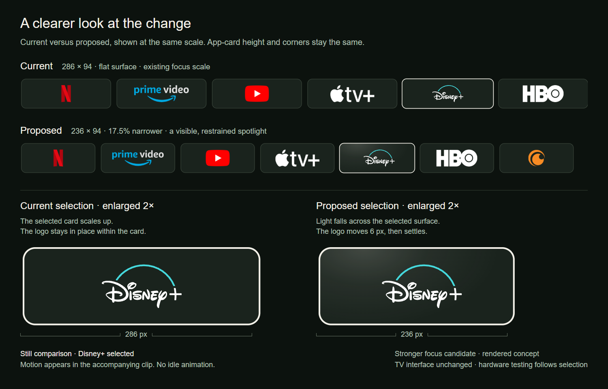
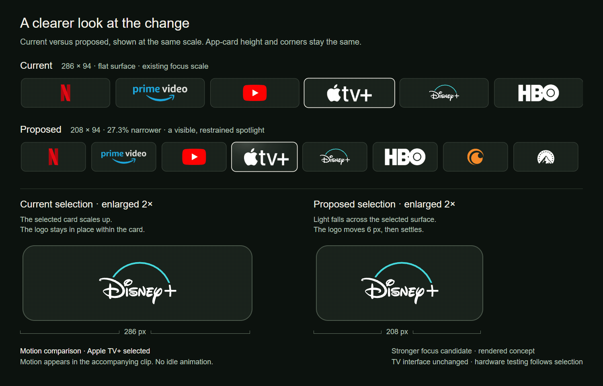

# Narrower app cards — approved design record

[← prettTV](../../../README.md) · [Native design](../../../DESIGN.md) · [Validation history](../../validation.md)

These browser-rendered **C Balanced** comparisons record the design approved for the native **v0.2.1** card update. They remain design previews, not screenshots of the installed Android app. The labels “Current” and “Proposed” in the images describe the earlier v0.2.0 baseline and the approved direction.

The comparison shows both rows at the same scale, with enlarged views of the selected card.

[Open the full-size comparison](comparison.png)

The approved C row uses **208 × 94** app cards instead of **286 × 94**: about **27.3% narrower**, with the existing height and corner shape. This followed an intermediate 236-pixel proposal. Dark logos retain their color accents, and the finite app row keeps its beginning and end.

| Treatment | Appearance and motion |
| --- | --- |
| **Earlier baseline** | Flat selected surface, with the existing 1.025 focus scale. |
| **Approved direction** | A localized ivory spotlight at up to about 18% opacity, plus 6 reference pixels of internal artwork movement over 180 ms. The existing 140 ms focus scale remains. |

## Native implementation

Your apps uses the same **208-reference-pixel width** and **18-pixel gap** in all three layouts:

| Layout | App-card dimensions |
| --- | --- |
| **A · Cinema** | 208 × 116 |
| **B · Quiet** | 208 × 176 |
| **C · Balanced** | 208 × 94 |

These are 1920-wide design-reference pixels, scaled to the display width, not Android dp. App-row heights are unchanged. The Library grid retains its six-column geometry and 154-reference-pixel height.

The native card component applies the clipped spotlight and bounded artwork drift to app and content cards, including Library tiles. The spotlight's peak alpha is `0x2E` (about 18%), fading across an ivory elliptical gradient. Artwork moves up to 6 reference pixels rightward as focus settles over 180 ms; text and progress do not independently drift. The existing 140 ms scale reaches 1.025 for app, show and sports cards; hero and compact cards keep their original scale.

Focus reversal retargets the finite transition from its current position. Hidden or detached cards cancel and settle their focus animations; disabled system animations apply the final state immediately. Landscape artwork reserves enough overscan for the movement, while contained portraits limit movement to their available side space. See the [native design specification](../../../DESIGN.md#elevation--depth) for the source-derived details.

## See the movement

[Open the animated comparison](focus-motion.gif) · [Download the MP4](focus-motion.mp4)

The clip repeats the demonstration; the native transition runs only when focus changes and then settles. The selected-card close-ups are enlarged 2× so the internal motion is visible. The spotlight is intentionally stronger than the first set of nearly identical stills.

These assets do not measure Android rendering or prove hardware behavior. They preserve the approved direction, while [validation history](../../validation.md) records completed native checks and their limits. No new test totals or hardware-performance result is claimed by this preview update.

## Credits

App marks reuse prettTV's existing assets from [Homarr Dashboard Icons](https://github.com/homarr-labs/dashboard-icons) under [Apache-2.0](../../../launcher/app/src/main/assets/app-icons/LICENSE.txt). Exact source files, revision, and modifications are listed in [the icon source manifest](../../../launcher/app/src/main/assets/app-icons/sources.json). Disney+ uses the existing adapted foreground paths with a cyan arc and no square background. The Paramount+ mark is displayed in white in these mockups. Brand names and trademarks belong to their respective owners.

Only this app-row comparison is published here; the local playback export, private playback links, and full personalized screen are not included.
