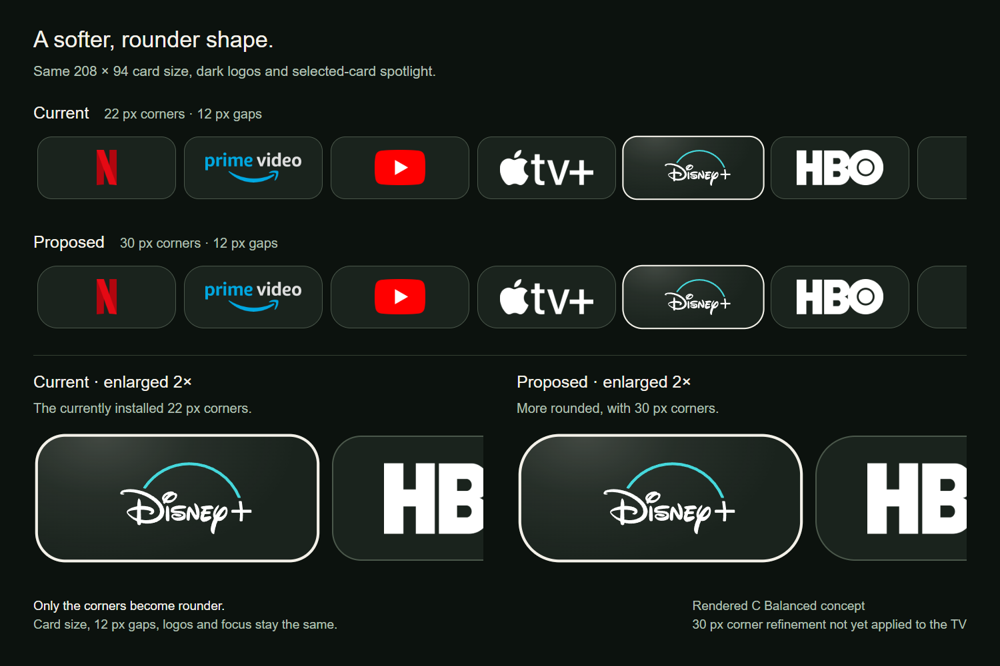

# 30-pixel app-card corners — superseded proposal

[← prettTV](../../../README.md) · [Historical v0.2.1 geometry](../rounder-app-cards/README.md) · [Approved 36-pixel corners](../rounder-36/README.md)

Rendered follow-up to v0.2.1's 22-pixel corners. **This 30-pixel proposal was superseded by the approved [36-pixel design for v0.2.2](../rounder-36/README.md).** The image's “Current” label refers to the historical v0.2.1 baseline.

[Open the full-size comparison](comparison.png)

Both rows use **208 × 94** C Balanced app cards with **12-pixel gaps**, the same logo sizes and the same selected-card focus effect. Only the corner radius changes from **22 to 30 reference pixels**. The lower details are enlarged 2×, with the neighboring card intentionally cropped to make the corner shape easier to compare.

The proposal applies only to Your apps in A/B/C, retaining their existing heights. Library and other content-card geometry stay unchanged. These are 1920-wide design-reference pixels, scaled to the display width. This browser-rendered concept is not a native TV capture or evidence of hardware performance.

App marks reuse prettTV's existing [Homarr Dashboard Icons](https://github.com/homarr-labs/dashboard-icons) assets under [Apache-2.0](../../../launcher/app/src/main/assets/app-icons/LICENSE.txt); exact provenance is in the [source manifest](../../../launcher/app/src/main/assets/app-icons/sources.json). Disney+ uses the existing adapted vector. Brand names and marks belong to their owners. No account data, viewing history or private playback links are included.
