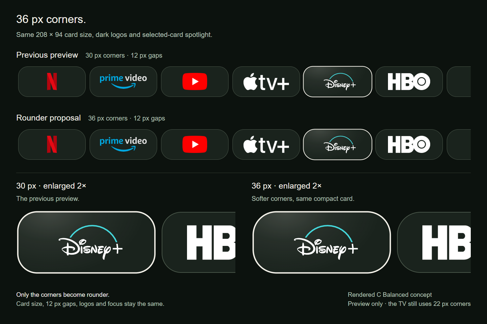

# 36-pixel app-card corners

[← prettTV](../../../README.md) · [Previous 30-pixel preview](../rounder-30/README.md) · [Earlier v0.2.1 geometry](../rounder-app-cards/README.md) · [Validation history](../../validation.md)

A rendered comparison of **30-pixel and 36-pixel corners**. The owner approved **36-pixel corners for v0.2.2**, replacing v0.2.1's 22-pixel radius only in the Your apps row.

[Open the full-size comparison](comparison.png)

Both rows use **208 × 94** C Balanced app cards with **12-pixel gaps**. Logo sizes, dark surfaces, selected-card spotlight and focus scale are identical. Only the corner radius changes. The lower details are enlarged 2×, with the neighboring card intentionally cropped to emphasize the shape.

The approved shape applies to Your apps in A/B/C, retaining their respective 116/176/94-pixel heights. Library, sports-app shortcuts and content-card geometry stay unchanged. Values are 1920-wide design-reference pixels, scaled to display width. This browser-rendered concept records the visual approval; [validation history](../../validation.md) records scoped native checks and outcomes.

App marks reuse prettTV's existing [Homarr Dashboard Icons](https://github.com/homarr-labs/dashboard-icons) assets under [Apache-2.0](../../../launcher/app/src/main/assets/app-icons/LICENSE.txt); exact provenance is in the [source manifest](../../../launcher/app/src/main/assets/app-icons/sources.json). Disney+ uses the existing adapted vector. Brand names and marks belong to their owners. No account data, viewing history or private playback links are included.
