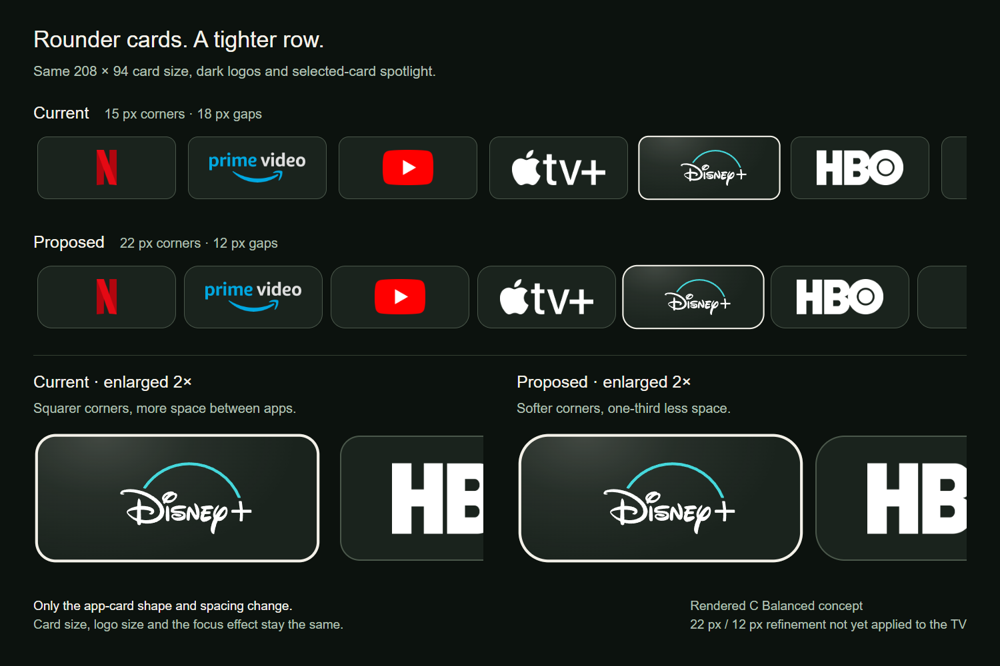

# Rounder app cards, tighter spacing

[← prettTV](../../../README.md) · [Earlier approved card size](../premium-focus/README.md)

Rendered comparison for the requested follow-up refinement. **This proposal is awaiting visual approval and is not installed on the TV.** The existing approved 208-pixel app width and focus treatment are retained.

[Open the full-size comparison](comparison.png)

| Your apps | Current candidate | Proposed |
| --- | ---: | ---: |
| Card width | 208 | 208 |
| C Balanced height | 94 | 94 |
| Corner radius | 15 | 22 |
| Gap between cards | 18 | 12 |

Dimensions are 1920-wide design-reference pixels, scaled to the TV's display width. The proposal affects Your apps in A/B/C; A retains its 116-pixel height and B its 176-pixel height. Library geometry and other content cards remain unchanged. Logo sizing, dark surfaces, the finite spotlight/artwork transition and the row's beginning/end are preserved.

Both rows use the same scale and the same selected app. The lower details are enlarged 2× to show the softer corners and one-third reduction in spacing. The adjacent card is intentionally cropped in those close-ups. These are browser-rendered concepts, not native captures or TV-performance evidence.

App marks reuse existing prettTV assets from [Homarr Dashboard Icons](https://github.com/homarr-labs/dashboard-icons), with the [source manifest](../../../launcher/app/src/main/assets/app-icons/sources.json) and [Apache-2.0 license](../../../launcher/app/src/main/assets/app-icons/LICENSE.txt). Disney+ uses prettTV's existing adapted vector. Brand names and marks belong to their owners. No viewing history, account data or private playback links are included.
