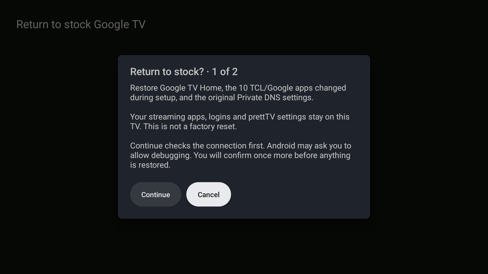
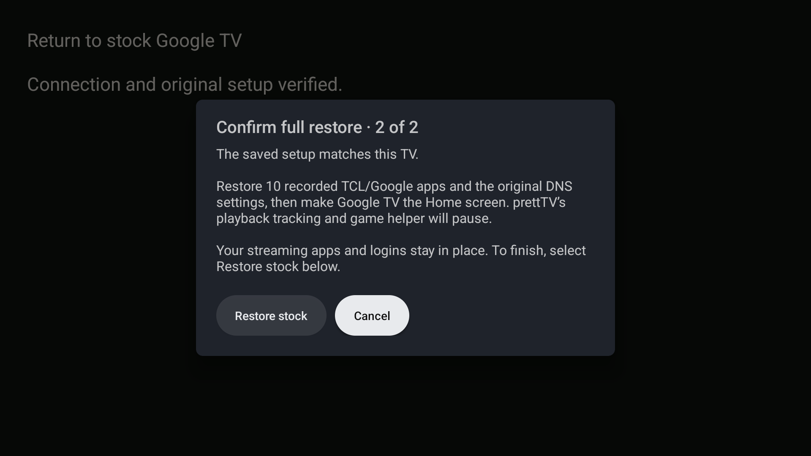

# Return to stock Google TV

[prettTV](../README.md) / [Documentation](README.md) / Stock recovery

The button at the bottom of **prettTV Settings → Return to stock Google TV** restores the TV's recorded setup for troubleshooting. It requires **two separate confirmations**, both starting on Cancel. Cancel or Back before restoration starts leaves the TV unchanged.

| Restored | Kept |
|---|---|
| Original Google TV Home app | prettTV and its settings |
| TCL/Google app states saved during setup | Installed streaming apps, their data and logins |
| Previous private DNS settings | Apps changed outside the recorded setup |

This is a troubleshooting restore, not a factory reset. Restoring the original apps and DNS can bring back stock recommendations, advertising and background services.

**Before you start:** import the original setup record, keep TCP debugging available, and keep the computer-side backup in case prettTV cannot run. [Configure recovery](#configure-recovery) or [use the button](#use-the-button).

## Configure recovery

A new prettTV installation cannot know which apps or DNS settings were changed previously. Full recovery is unavailable until the original setup record is imported. Do not guess a baseline from the TV's current state.

Keep the original `changes.json` and its snapshot directory outside this repository. The snapshot must contain `device-identity.json` and `home-activity.txt`. The journal's `snapshot` property points to that directory; a relative path is resolved beside the journal.

These files contain device-specific information. **Keep them private** and exclude them from GitHub and release bundles.

With the TV connected and authorized in ADB, open prettTV and run:

```powershell
./tools/configure-stock-recovery.ps1 `
  -JournalPath 'E:\PrivateTvBackup\changes.json' `
  -Tv 'TV_ADDRESS:5555' `
  -Adb 'E:\Android\platform-tools\adb.exe' `
  -AdbPort 5037
```

Use the serial or address shown by `adb devices`. `AdbPort` is the **computer's ADB server port**, not the TV's port.

The script checks the connected TV and foreground user against the saved serial number, firmware fingerprint and original Home activity, then imports the record into prettTV's private storage. Importing does not enable packages, change DNS or switch Home. No copy is written into the repository, and status output omits device identifiers.

<details>
<summary>Supported recovery records and exact restore behavior</summary>

The importer accepts completed user 0 `disable-user` entries only for the following packages. Google TV Home is required; unrecorded packages are left unchanged.

| App | Package |
|---|---|
| TCL TV+ | `com.tcl.tv.plus` |
| TCL Browser | `com.tcl.browser` |
| TCL Alexa | `com.tcl.smartalexa` |
| TCL e-sticker | `com.tcl.esticker` |
| TCL Interactive | `com.tcl.interactive` |
| TCL LogKit | `com.tcl.logkit` |
| Google Feedback | `com.google.android.feedback` |
| TCL Channel Plus | `com.tcl.channelplus` |
| Google TV setup | `com.google.android.tungsten.setupwraith` |
| Google TV Home | `com.google.android.apps.tv.launcherx` |

Each entry restores its exact recorded enabled state (0 through 4); the saved Google TV Home state must be default or enabled. The importer also requires the completed AdGuard changes to `global/private_dns_mode` and `global/private_dns_specifier`. A saved `null` value means the setting was absent and is restored by deleting that setting. No literal `null` hostname is written. Unsupported, duplicate or pending changes are rejected.

</details>

## Use the button

Android protects package state, DNS and the default Home app. The in-app restore needs an authorized ADB connection to the TV itself at `127.0.0.1:5555`. It does not connect to another device or use the computer's private ADB key.

**TCP debugging must already be enabled and remain available.** prettTV cannot enable it automatically or grant itself privileges. If debugging is later disabled, a computer may be needed to make it available again. Android may ask to authorize prettTV's own key on the first connection.

1. Open **Return to stock Google TV** at the bottom of prettTV Settings.
2. Read and accept the first confirmation.
3. Read and accept the second confirmation to start recovery. It expires after two minutes if no restore starts.
4. Wait for recovery to check and verify the result.

After both confirmations, recovery checks the saved identity, recorded states and stock Home before changing anything. It verifies the restore results and reports failures instead of claiming success. A missing baseline, unavailable debugging connection, firmware mismatch or conflicting later changes needs to be resolved first. Keep the original computer-side backup for recovery if prettTV cannot run.

If a restore is interrupted after some settings change, already-restored apps stay available and the result reports incomplete recovery. Reopen the button to recheck and retry; no automatic restore runs at startup.

<details>
<summary>View the two confirmation screens · actual TCL captures</summary>

Both screens begin with **Cancel** selected.

**First confirmation**



**Second confirmation**



</details>

## After a restore

After a successful restore, prettTV's optional playback tracking and game handoff helpers pause. If you return to prettTV later, **Resume prettTV helpers** in its Settings reactivates them using their existing Android permissions. Choosing prettTV as the default Home is a separate step.

> [!IMPORTANT]
> `restore.sh --stock-home` is a separate **uninstall helper**: it removes prettTV and does not restore the full disabled-app and DNS baseline. It is not a substitute for the in-app troubleshooting button.
